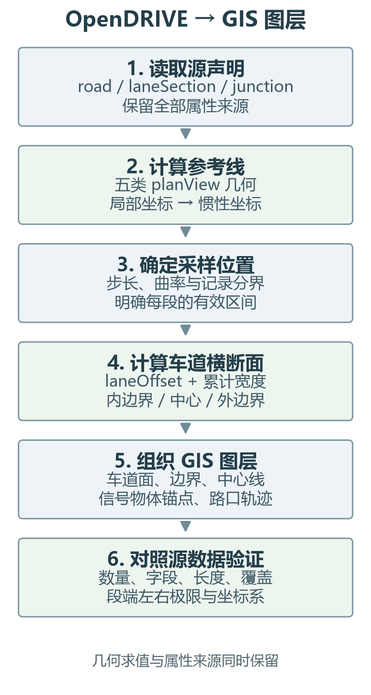
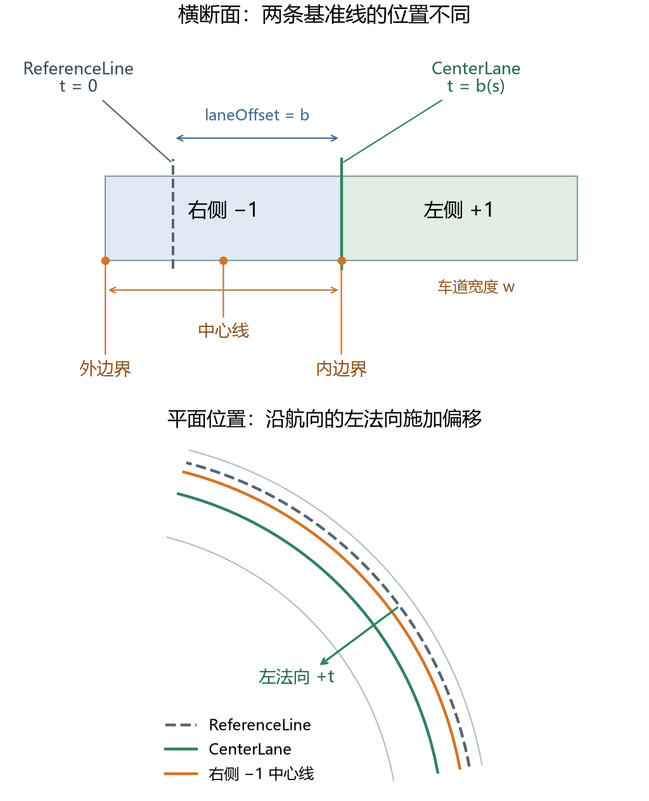
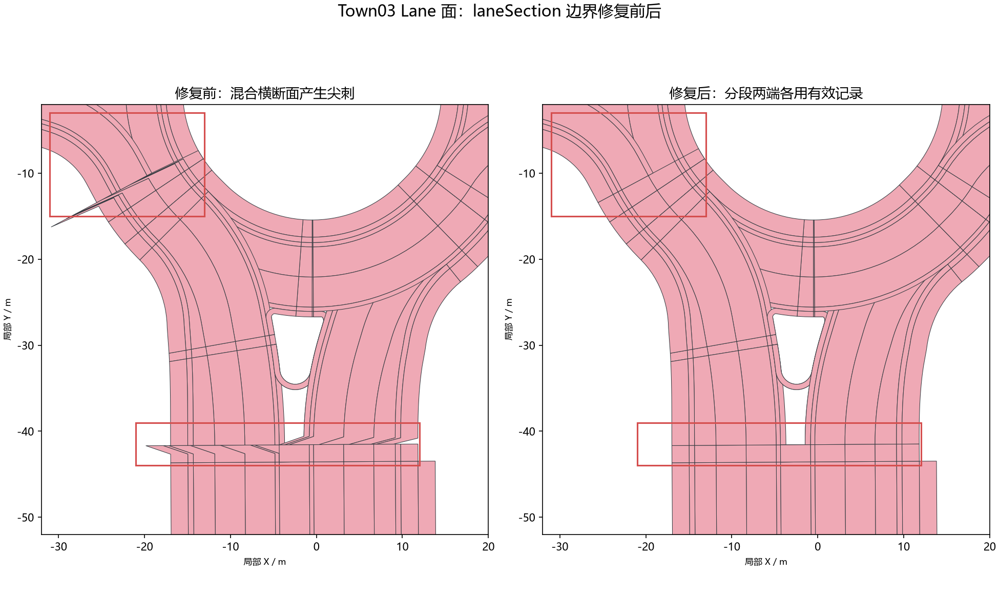

# 从 OpenDRIVE 中提取 GIS 图层的实现思路

## 1. OpenDRIVE 为什么需要先计算，再导出

OpenDRIVE 描述道路参考线、车道宽度、高程和连接关系。XML 里的一个 road 并不是现成的 GIS 折线，一条 lane 也不是已经闭合的多边形。要把道路放进 QGIS，需要先在参考线上确定采样位置，再计算每个位置的车道横断面，最后组织为点、线、面图层。

本文介绍一条用 Python 自行解析和计算的路线。重点是从参数到几何的过程，以及坐标起点、记录有效区间、车道重编号等容易影响数据正确性的细节。图层写入采用 GeoPackage，计算过程不依赖 GDAL 的 XODR 驱动。



计算参考线和横断面，保留源属性，再独立验证输出。

### 1.1. 本文解决哪些问题

全文沿着三个问题展开：参考线如何从参数变成坐标；车道如何从宽度记录变成面；输出的几何与属性如何回到源 XML 验证。配套文章分别讨论 [GDAL 官方驱动与 TIN 整理](基于GDAL官方驱动从OpenDRIVE中提取GIS图层.md) 和 [由车道中心线构建有向路网](基于车道中心线和junction%20line生成常规路网图层.md)。

### 1.2. 计算范围

| 内容 | 实现 |
|---|---|
| 平面参考线 | `line`、`arc`、`spiral`、`poly3`、`paramPoly3` |
| 采样 | 步长、曲率/航向约束，补入横断面记录分界和多项式极值 |
| 车道横断面 | `laneOffset`、`laneSection`、`width`，无 width 时采用 `border` |
| 高程 | `elevation`，默认写 Z；可选简化超高补偿 |
| 坐标 | `geoReference`，以及 `header/offset` 的平移和绕 Z 轴旋转 |
| 信号与物体 | `signal/object` 的位置锚点，包含 `zOffset` |
| 路口车道轨迹 | `laneLink`、`contactPoint`，跨段 predecessor/successor 重编号追踪 |
| 限速 | 统一 km/h、mph、m/s，车道缺省时继承 road/type/speed |

这是常用元素的实现，不能以 XML 版本号推断完整规范支持。`RoadMark`、物体轮廓/重复实例、完整三维道路姿态、车道高度和路拱、`singleSide=true` 的继承语义、direct junction 和较新车道方向规则尚未全面实现。

## 2. 先区分坐标与里程的起点

### 2.1. 三种坐标

| 坐标 | 含义 |
|---|---|
| `(x,y,z)` | 最终惯性/投影或局部笛卡尔坐标 |
| `(u,v)` | 一段 planView geometry 的局部平面坐标 |
| `(s,t)` | s 沿道路参考线，t 沿其左法向 |

**道路坐标的 t=0 在 ReferenceLine 上。** CenterLane 位于 `t=laneOffset(s)`，是车道宽度累加的基准。信号或物体的 t 是相对参考线的偏移，不能额外加一次 laneOffset。

左侧车道 ID 为正，右侧为负；每侧按绝对值由小到大计算。ID 表示车道的侧别和序号，不等于所有版本、所有道路上的行驶方向。行驶方向在路网篇单独处理。



虚线为参考线，绿线为 laneOffset 后的车道宽度基准。

### 2.2. 同名属性的里程不能混用

| 记录 | 起点 |
|---|---|
| geometry/@s、elevation/@s、superelevation/@s、laneOffset/@s、road/type/@s | road 起点 |
| laneSection/@s | road 起点，定义车道段边界 |
| lane/width/@sOffset、border/@sOffset、speed/@sOffset | 所在 laneSection 起点 |

三次多项式使用自身记录起点之后的距离：

```text
value(ds) = a + b·ds + c·ds² + d·ds³
ds = 查询里程 − 当前生效记录的起点
```

不能把 laneSection 内的 sOffset 当成 road 绝对 s。首个 width/border 记录须从段内偏移 0 开始，否则明确报错。相邻段可能只有微米间距，也不能用宽松浮点容差反查“最接近的段”。实现按 laneSection 的排序下标配对区间，并在该区间内求值。

## 3. 从参考线参数得到可查询的折线

### 3.1. 五种几何

`geometry_local()` 返回段内查询函数，输入为 0 到 geometry.length 的道路里程，输出局部坐标和航向增量。

| 元素 | 计算方式与边界条件 |
|---|---|
| line | `u=p, v=0` |
| arc | `u=sin(kp)/k, v=(1−cos(kp))/k`，k 接近零时退化为直线 |
| spiral | 曲率线性变化，积分 cos/sin 航向得到 u/v |
| paramPoly3 | 双三次多项式；normalized 时使用 `q=p/L`，arcLength 时使用 p |
| poly3 | `v=v(u)`，先积分 `ds/du=sqrt(1+(dv/du)²)`，再按弧长反查 u |

poly3 不能直接令 u=s。例如 `v=u`、声明长度 10 m 的直线，终点应为 `(7.071,7.071)`，不是 `(10,10)`。paramPoly3 使用输入声明的参数范围，数值质量和声明长度仍需通过参考线长度校验确认。

螺旋线的局部航向为：

```text
h(p) = ks·p + (ke−ks)·p²/(2L)
u(p) = ∫cos(h(q))dq
v(p) = ∫sin(h(q))dq
```

实现采用数值积分和插值。步数随长度和曲率精度需求增大，不能认为所有螺旋线都由固定少量点精确表达。

### 3.2. 两次坐标变换

先按 geometry 的起点和航向转换局部坐标：

```text
x = x0 + u·cos(h0) − v·sin(h0)
y = y0 + u·sin(h0) + v·cos(h0)
```

再应用 header/offset 的旋转 θ 和平移：

```text
X = ox + x·cos(θ) − y·sin(θ)
Y = oy + x·sin(θ) + y·cos(θ)
Z = oz + elevation(s)
```

offset 改变坐标值；geoReference 为这些坐标提供 CRS 定义。给图层设置 CRS 本身不会重投影或修正来源坐标。

### 3.3. 采样不能只看步长

仅按固定步长采样，可能漏掉紧弯和很短的宽度变化。设沿道路里程的步长为 step，允许的相邻航向变化为 max_turn，圆弧和螺旋线的点数至少满足：

```text
n ≥ ceil(L/step)+1
n ≥ ceil(L·max(|curvature|)/max_turn)+1
```

公式中的 max_turn 使用弧度；例如 5° 应先换成约 0.0873 rad。点数约束是离散近似的一部分，输出仍应通过长度和局部覆盖验证。

螺旋线采用首尾曲率绝对值的最大值。若用净转角，正负曲率相互抵消的 S 弯会漏掉大转弯。多项式曲线检查局部航向变化并二分细化。

采样还补入 elevation、superelevation、laneOffset、laneSection、width、border、车道 speed 的分界；三次多项式的导数根可作为内部极值点。这样短区间的宽度脉冲也有机会被采到。分界附近不连续的源记录仍可能形成局部几何异常，采样加密不能修复源数据本身。

### 3.4. point_at 是公共查询出口

Road 缓存 `S/X/Y/COS/SIN` 五条等长数组。查询参考点后，横向偏移为：

```text
X(s,t) = Xref(s) − t·sin(h)
Y(s,t) = Yref(s) + t·cos(h)
```

航向以 cos/sin 插值后再 atan2 还原，避免 ±π 附近直接插值角度导致方向翻转。

## 4. 从横断面到车道几何

### 4.1. 内边界、中心与外边界

设 b(s)=laneOffset(s)，w 为当前车道宽度，c 为同侧内侧车道累计宽度，σ 为侧别（左 +1，右 −1）：

```text
t_inner  = b + σ·c
t_center = b + σ·(c+w/2)
t_outer  = b + σ·(c+w)
```

每条车道输出 inner、center、outer 三条点列。Lane 用 inner 正序和 outer 反序组成闭合环；LaneBorder 只保留外边界；LaneCenter 保留中心点列。

宽度不是仅在段首读取的常数。实现按采样位置选择生效记录，限制在本 laneSection 的有效区间，并拒绝 NaN/Inf。负计算宽度裁到零，全段宽度小于 `1e-6` 的占位车道不输出。

#### 4.1.1. laneSection 两侧的记录归属

每段的有效区间是 `[sa,sb)`，几何闭合需要末点落在精确 `sb`。该末点的 laneOffset、width、border 取 **sb 左侧有效记录**，多项式仍在 sb 求值；下一段首点才取 sb 处开始生效的新记录。这样避免“下一段偏移 + 上一段旧车道宽度”的混合横断面，车道重编号和内侧占位车道增删时也不会产生假尖刺。

采样严格使用段内点，并显式加入精确 sa/sb，不用 `±1e−9` 借入相邻段的点。记录选择也不将下一记录提前生效；浮点加法产生的端点误差不会改变左右段的归属。

Town03 的 road 1737 在 s=2 m 同时调整 laneOffset 和内侧车道。如果用下一段偏移配上一段宽度，上一段末点会横移 2.865 m；road 1566 的同类错位达到 6 m。这是记录归属错误，不能靠加密采样或多边形修复消除。按左右极限求值后，Lane、LaneBorder、LaneCenter 和由车道中心线生成的 JunctionLink 使用同一正确横断面。



左列混用相邻段记录，右列按段末左极限计算，尖刺消失。

### 4.2. border 与 width

存在 width 时采用 width。只有 border 时，border 表示外边界位置，宽度由外边界与已累计内边界的距离求得，不能直接把 border 系数当宽度。border 与不相容的 laneOffset 定义、非连续或交叉的边界应按源规范先整理，不能靠本实现推断冲突记录的意图。

### 4.3. 高程与超高的实际边界

默认 Z 来自 elevation 和 header/offset.z。信号与物体还加各自的 zOffset；用于平面应用时可选择只保存 XY。

当前实现的简化超高补偿为：

```text
z += t·tan(superelevation(s))
```

它没有同时旋转横向 XY，也没有实现坡度、roll/pitch、crossfall、shape、lane/height、lane level 的完整组合。工具使用 --crossfall 这个历史参数名启用它，但该名字不意味着实现了完整路拱语义。它适合简单展示，不能据此做净空、工程断面或精确三维路面分析。

## 5. 八类图层的数据契约

### 5.1. 几何与标识

| 图层 | 默认几何 | 属性字段数 | 粒度和关联键 |
|---|---|---:|---|
| ReferenceLine | LineStringZ | 27 | 每 road；road_id |
| CenterLane | LineStringZ | 27 | 每 road；road_id；含 laneOffset 的车道基准线 |
| Lane | PolygonZ | 37 | 每非零宽车道段；road_id、lane_section、side、lane_id |
| LaneBorder | LineStringZ | 36 | 同一车道段的外边界，与 Lane 使用相同关联键 |
| LaneCenter | LineStringZ | 36 | 同一车道段的中心线，与 Lane 使用相同关联键 |
| RoadSignal | PointZ | 35 | 每 signal 锚点；road_id、signal_index；保留 signal_id |
| RoadObject | PointZ | 35 | 每 object 锚点；road_id、object_index；保留 object_id |
| JunctionLink | LineStringZ | 21 | 每声明 laneLink；junction_id、connection_id、lane_link_index |

字段数不含 GPKG 自带的 fid 和 geom。单层与全层导出使用同一字段集合；没有源要素的层可以不建表。lane_section 是按 s 升序排列的零起始下标，signal_index/object_index 是各自 road 内 XML 节点的零起始下标。只用 road_id/lane_id 无法区分跨段重号。

输出名称与官方相近不代表定义完全相同。自研 RoadSignal/RoadObject 是点，官方原始结果可能是 TIN；自研没有独立 RoadMark 几何图层，标线属性保留在车道的 road_marks_json 中。比较时必须同时看粒度、属性和几何类型。

### 5.2. speed 的单位和代表位置

Lane/LaneBorder/LaneCenter 的 speed 统一为 **m/s**，表示该车道段起点的限速。优先用 lane/speed，未取得已知值时继承当前 road/type/speed；`undefined`、`no limit` 或未给值保留空。ReferenceLine/CenterLane 的 speed 是 road 起点限速。

speed_max/speed_unit 保留代表值所对应的原始声明，speed_source 标明来自 lane 或 road。speeds_json 和 road_types_json 保存完整分段记录，包括 undefined/no limit 的原始文本。所有 speed 列固定为 REAL，源缺失或整列未知也不退化成 TEXT。

段内限速变化没有拆成独立 Lane 要素。路网下游另按方向与车道组求整段最小已知限速，并写为 km/h。两个字段不能重复乘 3.6。

### 5.3. JunctionLink 的接触端与重编号

laneLink 的 from 是进口路车道，to 是连接路接触端的车道。contactPoint=start 时沿 +s 追踪 successor；end 时从末段沿 −s 追踪 predecessor，并反转点列。

不能按全路相同 lane_id 简单拼接。Town06 road 415 的车道 −4 在下一段成为 −3，必须沿声明继续追踪。lane_ids 保存经过的车道 ID。缺少显式重编号时只允许相同 ID 延续；声明指向不存在的车道不会猜测其他车道。

对于没有 laneLink 的 connection，当前实现可输出连接路全部可用车道轨迹；此时 is_inferred=1、lane_link_index/from_lane=NULL，并且原始 laneLink 属性为空对象。显式声明使用 is_inferred=0，并保留每条 laneLink 的下标和全部属性。默认数量校验主要面向带 laneLink 的输入，推导轨迹应独立核对生成数。显式声明 laneLink 但连接路没有可用车道时，转换失败并保留旧结果。

### 5.4. 固定列与结构化来源配合

GIS 表的固定列负责常用查询：road_id、车道段、lane_id、类型、限速、s/t 和上下游等。ID 与枚举通常保留为文本，长度、角度和统一后的 speed 使用实数，车道号与段下标使用整数；未知值保持 NULL，不凭显示需要填入默认值。

同一个 lane 可以有多条 width、speed、roadMark 和 access 记录，一个 object 也可能有轮廓、重复实例、材质与停车位子记录。若把每类记录只取第一条放进固定列，就会丢失分段变化；若全部展开成大量宽表，又难以处理扩展字段。这里用固定列提供代表值，再用 JSON 保留完整记录数组。

例如，speed 表示车道段起点的已知限速，speeds_json 保留本段所有变化；predecessor_lane 和 successor_lane 便于查询车道连接，lane_link_json 保留完整声明。RoadObject 仍然是位置锚点，但 outlines_json 和 repeats_json 保存实体来源，便于后续重建几何。

每层的 source_attributes_json 与 source_children_json 进一步保留未知直接属性和子树。完整字段速查放在配套工具说明，技术上最重要的约束是：固定列与 JSON 来源要能互相核对，NULL 类型不能因整列为空而改变。

### 5.5. JSON 记录与文件级属性来源

每条嵌套 XML 记录采用统一结构，属性值保持原始字符串，数组按源节点顺序保留：

```json
{"tag":"speed","attributes":{"sOffset":"0","max":"36","unit":"km/h"},"text":"","children":[]}
```

缺少直接属性在 source_attributes_json 中表现为没有对应键；没有子记录为 `[]`。source_children_json 保留节点名称、直接属性、有效文本和嵌套 children，未知扩展属性也不会丢失。这是解析后的属性来源，不是逐字节保存的 XML；注释、格式空白和原始 CDATA 排版不保留。

GPKG 的数据集元数据只保存一份完整属性来源，即使仅输出某个图层也保留：

| 元数据键 | 内容 |
|---|---|
| xodr_attribute_schema | 当前字段契约版本 2 |
| xodr_document_json | OpenDRIVE 根属性及除 road/junction 外的子树，包括 header/offset、controller 等 |
| xodr_roads_json | 全部 road 的完整属性树，包括零宽占位车道、signals/objects 和引用 |
| xodr_junctions_json | 全部 junction 的完整属性树 |

属性完整性应直接与源 XML 比较，不能只检查“字段存在”。例如删除一条 speed 子记录、把 NULL 整数列写成 REAL、遗漏跨 road 的 signalReference，图形可能完全不变，但下游已经无法正确解释数据。保存结构化来源后，可以独立检查这些差异。

## 6. 几何有效与道路正确之间的差别

### 6.1. 自交修复是有损选择

偏移曲线在紧弯中可能翻折，车道宽度也可能收缩到零后再次出现。make_valid 的结果可能包含 Polygon、MultiPolygon 和线状退化部件。实现递归提取面片，并保留面积最大的一块；self_intersect=1 表示进行了修复。

这种处理保证最终面可用，但会丢弃其他面片。LaneCenter 保留原参数轨迹，因而在这类车道上未必完全落在保留下来的面内。校验应报告这一差异，不应把有效 Polygon 当成道路物理正确的证明。

### 6.2. CRS 来自源文件

非空 geoReference 解析失败会报错。缺少 geoReference 时输出局部坐标，不猜 EPSG；本地 pyogrio 的“未提供 CRS”提示符合这一情况。

compound CRS 是否保留取决于源投影定义和驱动能力。本项目没有自动拆 CRS 或重投影；校验使用 CRS 语义比较并忽略轴顺序差异。

## 7. 怎样验证提取结果

### 7.1. 从源声明独立计算预期结果

生成器和校验器若使用同一份错误中间结果，很容易同时给出“正确”的结论。验证时应从源 XML 独立统计和求值，至少检查以下关系：

1. 选定图层数量和 CRS。
2. NULL、空、无效几何，以及坐标有限性。
3. ReferenceLine 平面长度与声明长度的相对误差小于 1%。
4. Lane 面积、段长和平均宽度（不大于 30 m）。
5. Lane/LaneCenter 的段标识一一对应，以及中心线在面内的覆盖情况。
6. 每层固定字段集合、SQLite 列类型及 road/段/lane 或 signal/object/laneLink 来源关联。
7. 普通属性值、完整 JSON 子记录、跨 road 引用和文件级 XML 属性来源与源文件一致。
8. Lane/LaneBorder/LaneCenter 的段首、段末与源横断面一致。独立从 XML 计算左右极限，不调用车道生成器；XY 允许 1 cm 的源 planView 毫米级接缝残差，米级错位直接失败。

### 7.2. 故意构造错误，检查校验器能否发现

用一条简单直线就能验证坐标变换和宽度累加；用正负曲率相互抵消的 spiral 验证采样；用只有微米长度的 laneSection 验证记录归属。还应构造“几何合法、横断面错误”的面，确认校验不能只依赖 is_valid。

属性测试同样需要反例：故意删除字段、修改源限速、丢失 JSON 子记录或将 REAL 写成 TEXT，再检查校验是否失败。只有正常样例通过，无法证明异常能够被发现。

### 7.3. 源声明缺失与退化几何应分别报告

福田样例中的一个 junction 声明连接到 road 256 的车道 −1，但该 road 只有 center lane。这样的连接没有可计算的车道轨迹，应明确指出来源，不能靠附近道路猜一个替代轨迹。

另一些车道虽然有完整参数，偏移后却形成自交条带。保留最大面片可以使 Polygon 合法，但原中心线可能落在被舍弃的面片上。此时应同时报告几何修复和面内覆盖差异，不能把“输出成功”当成“全部正确”。

## 8. 实现时最需要守住的边界

从 OpenDRIVE 提取 GIS 图层，核心是统一三个约定：所有记录在自己的里程起点后求值；车道横向偏移以参考线和 laneOffset 的关系为准；每个输出要素都保留明确的源关联。相邻段边界取错记录，往往比采样步长稍大更容易造成米级错误。

八类图层覆盖参考线、车道面、边界、中心线、信号物体锚点和路口车道轨迹。标线表面、完整实体模型和精确三维路面需要进一步实现对应语义；由中心线得到可导航路网，还需要处理行驶方向、车道组节点和转向关系。

配套代码的运行环境、调用方法、参数与输入输出说明见 [项目使用说明](../README.md#3-python-脚本如何调用和传参)；GDAL 提取和路网建模分别见系列另外两篇。
