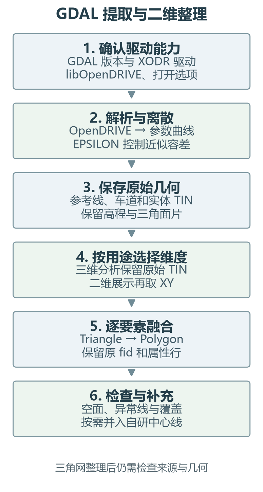
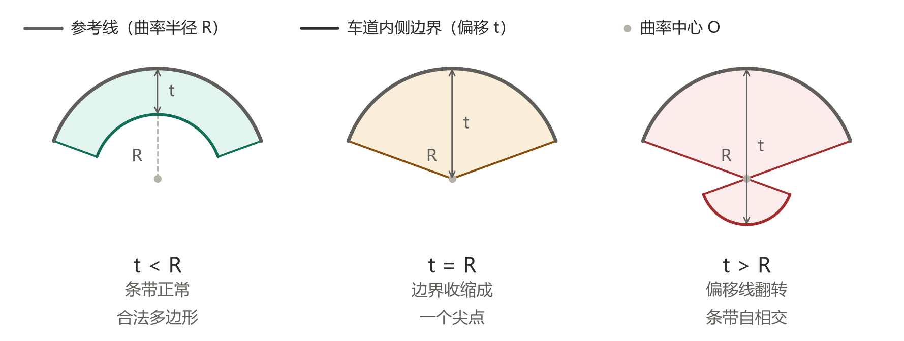
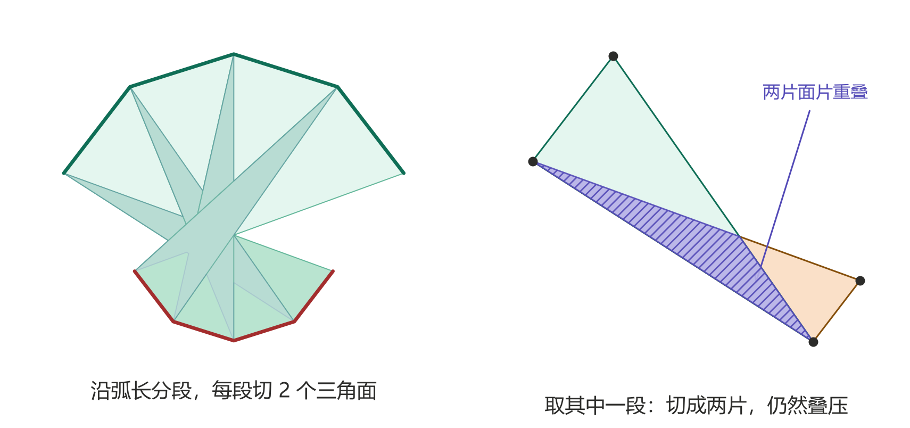
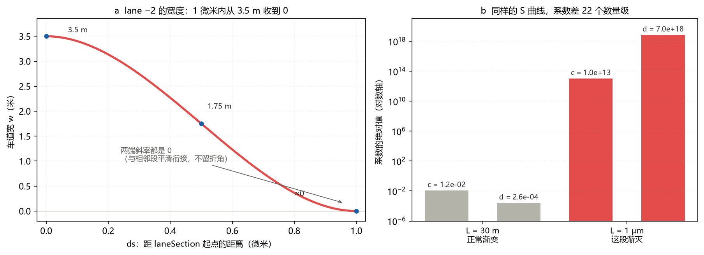

# 基于 GDAL 官方驱动从 OpenDRIVE 中提取 GIS 图层

## 1. 用官方驱动提取，为什么还需要整理

OpenDRIVE 用参数描述道路，而 GIS 软件通常处理点、线、面。GDAL 的 XODR 驱动借助 libOpenDRIVE 解析参考线、车道和道路实体，把它们离散成可交换的几何。与自行计算车道横断面的路线相比，官方驱动还能提供标线和部分实体表面。

转换后的车道常以 TIN 三角网保存。把这些数据直接放进二维地图，可能看到密集三角边、投影后消失的物体，或者长度异常的边界线。理解这些现象，需要区分三个步骤：参数离散、三维表面表示、二维整理。



保留原始几何，再按用途取 XY、融合三角面或补充中心线。

配套文章分别介绍 [自研提取的参考线与横断面计算](从opendrive中提取GIS图层的实现思路.md) 和 [车道中心线的有向路网建模](基于车道中心线和junction%20line生成常规路网图层.md)。本文集中讨论官方驱动的几何表示、整理流程和质量边界。

## 2. 先确认驱动实际支持什么

### 2.1. “有 GDAL”不等于“有 XODR 驱动”

XODR 是 GDAL 3.10 起提供的矢量驱动，需要编译时启用 libOpenDRIVE 和相应几何库。某个 Python 环境能读写 GeoPackage，只能证明 GPKG 驱动可用，不能证明它能读取 OpenDRIVE。

发行包、本机编译版本和容器镜像的驱动集合可能不同。选择运行方式前，应实际查询驱动，并记录 GDAL、libOpenDRIVE 版本。驱动的支持范围和选项以 [GDAL XODR 官方文档](https://gdal.org/en/stable/drivers/vector/xodr.html) 为准。

### 2.2. 能读取文件，不等于完整实现其版本语义

官方驱动文档声明支持 OpenDRIVE 1.4。较新文件中仍兼容的元素可能正常读取，但新版本的方向、连接或实体语义未必都被处理。

因此，版本号只能帮助确定需要检查的范围。转换后仍要核对 road、lane、signal、object 数量，并检查新增元素是否保留；不能仅凭“文件是 1.6”就断言完全不支持，也不能凭“转换成功”就宣称完全支持。

### 2.3. 离散精度需要可复现

EPSILON 控制 libOpenDRIVE 的曲线、曲面近似容差。它与自研路线沿道路里程的最大采样步长不同，两个参数取相同数值，不代表输出精度相同。

减小 EPSILON 通常会增加顶点和文件体积，但实际误差仍受源记录连续性、极短车道段和三角化影响。比较两套结果时，应固定源数据、驱动版本和打开选项，再比较长度、面积、覆盖与局部形状。容器的 latest 标签会变化，重复试验应使用固定标签或 digest。

## 3. 官方输出中有哪些几何

### 3.1. 六类图层

| 图层 | 常见原始几何 | 表达内容 |
|---|---|---|
| ReferenceLine | LineStringZ | road 的参考线 |
| LaneBorder | LineStringZ | 车道边界，包含中心车道的基准边界 |
| Lane | TINZ | 车道表面三角网 |
| RoadMark | TINZ | 道路标线表面 |
| RoadSignal | TINZ | 信号或标志的表面 |
| RoadObject | TINZ | 道路物体表面 |

实际类型应以文件的几何元数据为准。打开选项、源内容和驱动版本都可能影响结果。

LaneBorder 中的 lane ID=0 表示中心车道基准边界。比较非中心车道数量时应按 ID 区分，不能简单删除 Type=none，因为真实非中心车道也可能使用 none 类型。

### 3.2. 与自研图层比较时先统一含义

自研路线额外生成含 laneOffset 的 CenterLane、逐车道 LaneCenter 和 junction 车道轨迹 JunctionLink。官方六层不直接提供这三种结果，名称相近的其他层也不能替代它们。

RoadSignal 和 RoadObject 的差别更明显：自研实现保存位置锚点，官方原始几何可能保存表面。比较点到表面的距离、比较要素数量、比较二维面积，分别回答不同问题。没有先明确粒度与表示方式，数值相近也可能得出错误结论。

## 4. TIN 能表达什么，不能解决什么

### 4.1. 三角面片适合传递表面

TIN 由三角面组成，可以表达坡度、超高和复杂实体的局部表面。顶点保留 Z，面片之间保留边界，适合三维数据交换。

二维软件若给每个三角面描边，就会出现密集网格。部分读取库还不能直接处理 TIN 类型。这些现象首先是几何表示和软件能力问题，不应把所有三角边解释为道路裂缝。

### 4.2. 三角化不能消除偏移条带的翻折

车道由参考线的法向偏移得到。二维偏移的局部尺度近似为 `1−κt`，其中 κ 为参考线曲率，t 为横向偏移。内侧偏移接近曲率半径时，偏移线可能收缩；超过曲率半径后，条带可能翻折或自交。



偏移小于、等于和大于曲率半径时，条带逐渐收缩并翻折。

把条带分成三角形后，每个三角形可以合法，整体面片却仍然互相覆盖。



三角化只离散表面，不能消除条带翻折或重叠。

## 5. 从三维三角网整理为二维图层

### 5.1. 转换时融合与事后整理

官方打开选项 DISSOLVE_TIN=YES 可以融合 Lane 和 RoadMark 的单要素三角网，并将 RoadSignal 简化为点。RoadObject 不属于同一处理范围，仍可能保留 TIN。

另一种方式是先保留原始 GPKG，再逐要素读取三角面、取 XY 并融合。两种方式的共同点是**要素内融合**，不会自动把不同车道合成整个路面。

| 处理方式 | 保留内容 | 主要边界 |
|---|---|---|
| 保存原始 TIN | 三角面、顶点 Z、实体表面表示 | 二维显示和读取支持可能受限 |
| 驱动内融合 | 受支持图层的要素粒度和属性 | 图层处理范围由驱动决定 |
| 事后取 XY、融合 | 每个源要素的二维足迹和属性 | 竖直表面会退化，三维关系丢失 |

### 5.2. 逐要素整理的处理流程

1. 从 GeoPackage 元数据获取真实几何列和 CRS。
2. 剥离 GeoPackage 头和 envelope，再解析 TIN 的三角 patch。
3. 每个要素取 XY，滤掉面积退化的三角面，融合为 Polygon 或 MultiPolygon。
4. 保留源 fid 和全部属性；普通点、线也按目标维度复制。
5. 分别记录 NULL、空面、解析异常和融合异常，写完完整结果后再替换目标。

读取二进制几何时不能假设所有表都使用同一个几何列名，也不能只按 TIN 的外层类型处理任意曲面。实现需要明确支持的 TIN/Triangle/Polygon 类型和维度；遇到未知扩展应报告异常，而非静默生成一个看似合理的面。

### 5.3. 属性行保留，不代表几何一定可见

竖直标志牌在 XY 投影后可以成为线，细杆可以退化为点。整理为面时，它们可能没有可用面积。Town01 的 22 个 RoadObject 在一个二维整理样例中全部变成空面，但属性行仍然存在。

NULL 和空几何也应区分：NULL 表示没有几何值；空 Polygon 表示面类型存在、却没有面积。比较时应分别统计要素总数、非空几何数量和有效几何数量。

GEOS 面运算主要基于 XY。即使某些结果仍带 Z，也不能依靠交点插值恢复真实道路表面。精确三维、工程断面和桥下净空分析应使用保留三维信息的原始数据。

### 5.4. 中心线补充是数据组合，不是重新推导交通规则

可以把自研的 CenterLane、LaneCenter、JunctionLink 加入官方整理版。合并前核对 CRS；合并时保留来源字段类型、NULL、层级元数据和属性来源，避免空整数列经读取后变成浮点列。

官方六层的二维整理结果与自研带 Z 的线层可以共存。整个文件有 Z 图层，不代表每一层都是完整三维；JunctionLink 的几何存在，也不代表信号、车辆限制等交通规则已齐备。

## 6. 极短记录为什么会产生巨大异常

### 6.1. 系数很大，可能只是区间很短

Town03 的 road 575 含约 1 µm 的 laneSection。某条宽度为 3.5 m 的车道需要在此区间内平滑收窄到零。若首末斜率均为零，可以写成：

```text
w(ds) = a + c·ds² + d·ds³
c = −3a/L²
d = 2a/L³
```

当 L=1e−6 m，c 约为 −1.05e13，d 约为 7e18。系数巨大来自长度尺度，而在有效域内，归一化后的表达仍是 `w=a·(1−3u²+2u³)`，其中 u=ds/L。



相同渐灭形状放在不同长度区间，系数可相差许多数量级。

### 6.2. 越界求值会把尺度差放大

如果把相邻 laneSection 匹配到同一区间，或把段内 sOffset 当成道路绝对里程，就可能在极短记录上使用错误的 ds。三次项会迅速放大，输出远离地图范围的坐标。

一份已有官方 Town03 结果中存在约 `5.77e11 m` 的 LaneBorder，同源 RoadMark 也有融合异常。这个现象提醒我们检查记录区间，但仅凭旧产物不能断言所有 libOpenDRIVE 版本都有同一内部错误。定位驱动问题应固定版本和选项，再用最小源样例重现。

### 6.3. 异常过滤必须保留解释

原始文件应保留异常值，便于追踪来源。整理版若把异常长线置 NULL，仍应保留其属性并记录阈值；统计总长时若再排除长线，也应说明统计口径。

示例工具对二维复制使用 1,000 km 阈值，对 A/B 比较总长使用 100 km 阈值。两者用途不同，不能省略阈值后宣称“数量一致、长度一致”。异常消失只说明过滤生效，需要继续检查被过滤要素的 road 和 lane 来源。

## 7. 路面展示与车道数据应保留不同粒度

把所有 Lane 求并集，可以得到二维路面底图。再进行半径 r 的闭运算：

```text
U = union(Lane)
Pavement = U.buffer(r).buffer(−r)
```

闭运算可以填补窄缝，却也会改变小岛、边界尖角和窄空地。跨车道 union 还会丢失 lane 归属、高程关系和重叠结构。因此 Pavement 适合地图背景；车道拓扑、交通容量和车道级分析仍应使用原始分车道数据。

缓冲半径应以平面距离单位解释。地理坐标不能直接把 r=0.2 当作 0.2 m；没有 CRS 的局部坐标也要确认单位。

## 8. 比较两条提取路线时看什么

| 检查维度 | 要回答的问题 |
|---|---|
| 数量与粒度 | 是否遗漏 road/lane？中心 lane、段拆分和推导轨迹是否被重复计入？ |
| 长度与面积 | 是否按相同维度和过滤口径比较？有没有极端值？ |
| 局部覆盖 | 总量相近时，边界和中心线是否仍有错位？ |
| 属性 | fid、车道段、来源 ID、NULL 和字段类型是否保持？ |
| 维度与实体 | 点、面、TIN 是否在表达同一种对象？Z 是否有实际物理意义？ |

1 m 缓冲区内的边界覆盖率可以帮助发现二维位置差异，但无法替代逐车道归属、三维表面和交通语义检查。两条路线互为对照，源 XML 仍是判断声明和记录归属的依据。

官方驱动适合快速获得参考线和表面几何；二维整理使这些几何适合平面使用。要得到车道中心线或有向路网，还要补充对应计算和建模步骤。环境准备、脚本调用、参数与输入输出说明集中在 [项目使用说明](../README.md#3-python-脚本如何调用和传参)。
