# 基于OpenDRIVE路网生成宏观Link路网图层

OpenDRIVE 可以生成车道面、车道中心线和路口转弯线，用于车道级展示和微观仿真。但是做宏观路况表达或道路级路径规划时，逐车道的路网往往过细。因此，希望从同一份数据中提取道路级路网，并保留与车道级路网的对应关系，让一套数据适配不同层次的应用，比如用OpenDRIVE路网做仿真计算，用宏观路网来展示路况和流量。

## 1. 宏观路网要素

### 1.1. Link和Node

假设车辆从 A 行驶到 B，A、B 各是一个 Node，路网里用一条 Link 表示这段路。Link 的第一个坐标在 A，最后一个坐标在 B，点列顺序就是行驶方向。

车辆从 B 回到 A，要用另一条方向相反的 Link。这样地图上的箭头、路段的起终点，以及路径算法使用的方向是一致的。

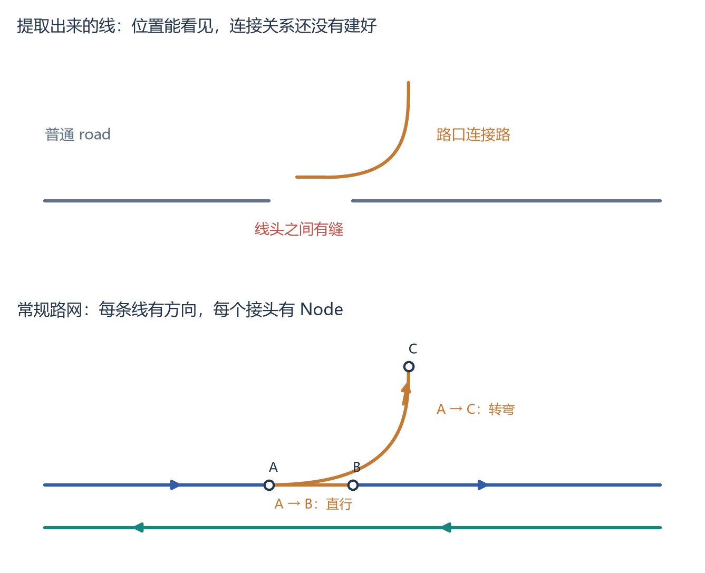

上图是原始线层，下图补上方向和节点。A→B 为直行，A→C 为转弯。

Node 表示接头。同一个十字路口可以有多个 Node，分别位于不同进口、出口和车道组的连接处。

### 1.2. 多车道合并成一条Link

如果一段路有三条向北的车道、两条向南的车道，我们通常输出两条主 Link：一条向北，lanes=3；一条向南，lanes=2。需要单独表达的渐变辅道，再增加 aux 类型的 Link。

road 是 OpenDRIVE 中的一段道路定义，一条实际道路可能拆成多个 road。按 road 和行驶方向生成 Link，可以简化逐车道网络，便于道路展示和路径分析。代表线只概括道路级路径；精确车辆轨迹、变道许可和信号控制仍需更细的交通模型。

### 1.3. Link和ReferenceLine、CenterLane、LaneCenter、JunctionLink区别

| 名称            | 可以怎样理解                     | 主要用途            |
| ------------- | -------------------------- | --------------- |
| ReferenceLine | OpenDRIVE 画道路时使用的参考线       | 定义道路的里程和航向      |
| CenterLane    | 加上 laneOffset 后，累计车道宽度的基准线 | 计算各条车道的位置       |
| LaneCenter    | 每条物理车道自己的中心线               | 展示、分析具体车道       |
| JunctionLink  | 根据路口车道连接关系得到的连接线           | 表达路口内的车道路径      |
| 路网 Link       | 一个行驶方向、一个车道组的代表线           | 构建 Node/Link 路网 |

laneOffset 是参考线到车道计算基准的横向偏移，可以沿道路变化。CenterLane 表示这个基准，可能位于两方向道路之间，也可能在车道带的一侧。把它直接用于两个方向，会让两条 Link 落在同一位置。

## 2. 先选车道、定方向，再算代表线

### 2.1. 车道筛选

默认纳入 driving 和 bidirectional 类型的车道。路肩、停车带、人行道、中央分隔带等不自动进入路网。需要纳入 onRamp、offRamp 等类型时，按数据约定增加允许类型；路肩掉头例外见第 10 节。

laneSection 是使用同一套车道定义的区间。车道类型可能跨段变化：同一个 lane ID，前段是 driving，后段可能变成 shoulder，因此每段都要检查。

筛选决定哪些车道参与代表线。**计算位置时，仍要累计内侧所有物理车道的宽度。**例如，内侧占位车道宽 2 m，忽略它会让外侧车道向内错移 2 m。

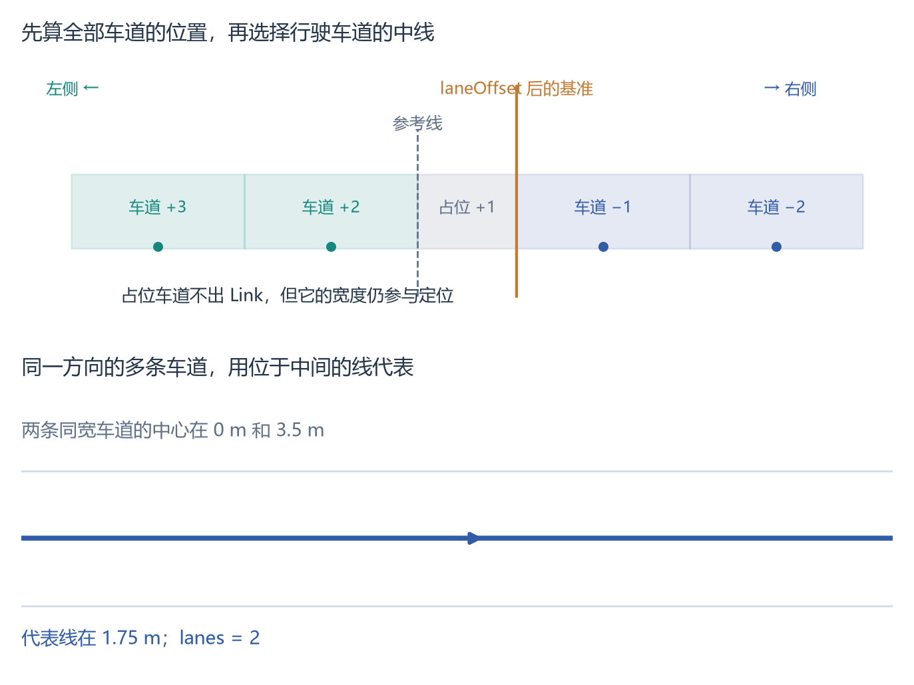

上图先算完整车道位置，再筛选；下图取两条车道中心线之间的中点作为代表线。

### 2.2. 车道运行方向

OpenDRIVE 的 s 是沿参考线增加的里程，未必与车辆行驶方向一致。判断方向时，先看通行规则，再看车道声明。

- RHT 表示右侧通行：默认右侧车道沿 s 增大方向行驶，左侧相反。
- LHT 表示左侧通行：默认方向与上面相反。
- lane 的 direction=standard 使用默认方向，reversed 将它反转，both 允许双向。
- type=bidirectional 也按共享双向车道处理。

车道 ID 的正负主要表示物理侧别，不能脱离 RHT/LHT 和 direction 声明，直接把正负号等同于某个实际行驶方向。

### 2.3. connection运行方向

路口的 connection 用 contactPoint 指明车辆接入 connecting road 的哪一端：

- start：从源起点进入，沿 s 增大方向走。
- end：从源终点进入，沿 s 减小方向走，输出点列要反转。

同一条连接路可能被多条 connection 引用。实现按方向去重，不因为它被重复引用就多生成一份 Link；共享双向车道则补上另一个可用方向。

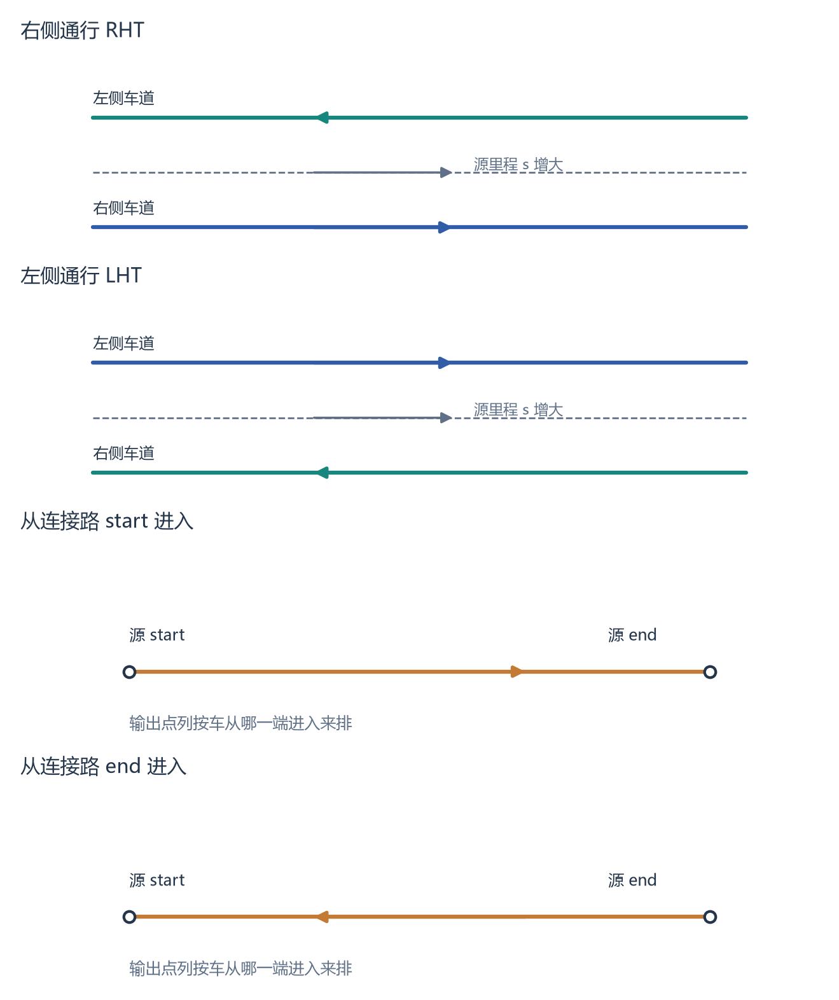

上两幅比较 RHT、LHT；下两幅比较从 start、end 接入，箭头均为行驶方向。

### 2.4. Link提取

在每个采样位置，先得到该方向所有有效车道的中心位置，再取横向中位数。三条车道时取中间一条；两条车道时取两条中心线之间的中点。

这不是简单地把参考线向左、向右平移一个固定距离。laneOffset、宽度、车道数变化，都要在当前位置重新计算。弯道上外侧代表线比内侧长，也是正常的几何结果。

显式启用向基准线收拢时，位移受 road 长度限制；短路段会缩小位移，留出过渡空间。这不是默认处理。

## 3. 车道处理

### 3.1. 双向车道

所有 Link 均为单向，oneway=1，点列顺序与行驶方向一致。双向通行用两条反向 Link 表达，不另设 dir、FT/TF 字段。

| 源数据的情况            | 主 Link 数量 | 几何如何表达                  |
| ----------------- | --------: | ----------------------- |
| 左右各一条普通单向车道       |         2 | 各走自己的车道中线               |
| 只有一个允许方向          |         1 | 点列顺序与该方向一致              |
| 一条车道本身允许双向        |         2 | 同一条中线，坐标顺序相反            |
| 同一 road 有两条共享双向车道 |         2 | 按方向聚合；每条 lanes=2，不复制成四条 |
| 普通车道与共享双向车道混合     |   每方向一条主组 | 只聚合该方向可用的车道，保留共享来源标记    |

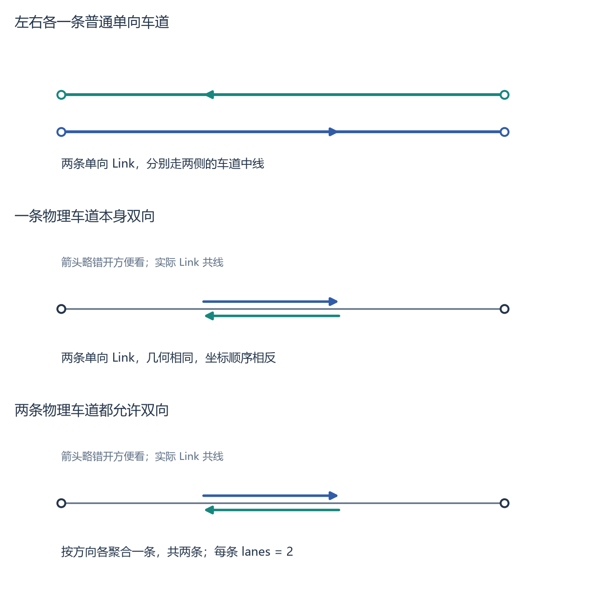

共享车道的箭头略错开便于辨认，实际两条反向 Link 可以共线。

检查重复线时，还要核对共享车道来源、起终点和点列方向。共享车道的反向共线允许，同一方向重复输出仍是错误。

存在共享双向车道时，当前实现不再从这个方向拆出重复 aux。如果双向声明只存在于局部 laneSection，road 级代表线可以保留相应方向，但不据此证明整条 road 全段都能双向通行。

### 3.2. 车道跨段换号，仍可能是同一条车道

一条车道从上一段的 −3 换成下一段的 −2，再换成 −1，并不一定是三条不同的通道。应沿车道的 predecessor/successor 追踪它们之间的连接。

车道数 lanes 取“沿路某个位置同时有效的最大车道数”。同一方向前段两条、后段三条，lanes=3；不能把两段相加成五条，也不能把所有出现过的 ID 数量当成车道数。

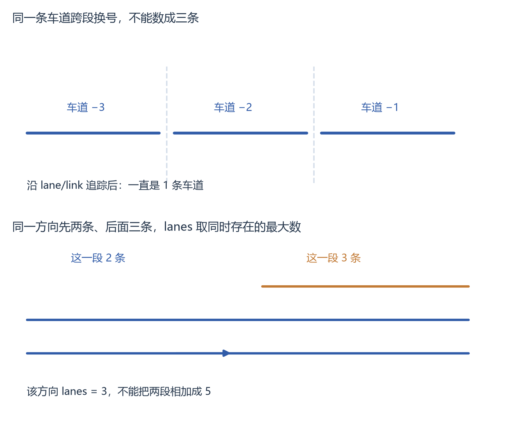

上图跨段换号后仍是一条车道；下图最大同时车道数为三条。

lanes 不代表每一处都有这么多车道。按车道增减位置分析容量时，还需按 laneSection 拆边。

### 3.3. laneSection边界处理

曾出现过车道面在 laneSection 分界处伸出尖刺的问题：上一段末点用了下一段的新 laneOffset，却仍累计上一段的旧宽度。

上一段末点应在精确分界里程求值，但沿用本段有效的 laneOffset 和宽度记录；下一段首点才使用新记录。采样点也要严格归属各自区间，避免因宽松容差混入相邻段。

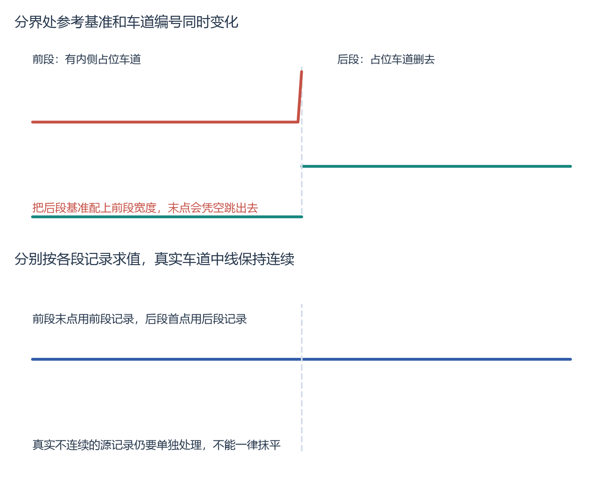

绿线为计算基准，红线示意混用记录造成的假跳点。

## 4.  节点Node处理

### 4.1. 给每个车道组的两端登记一个节点

建网时先登记尚未合并的接头，记录所属 road、位于哪一端、行驶方向和车道组。

普通道路每个方向各有首末两个节点；有独立辅道或混合连接组时，再分别登记。之后按源连接关系判断哪些节点应共享一个 Node。

同一 road 端的普通反向车道通常各有节点；共享双向车道可以在同一位置共用节点。不能只因属于同一 road 或 junction，就把所有节点合并。

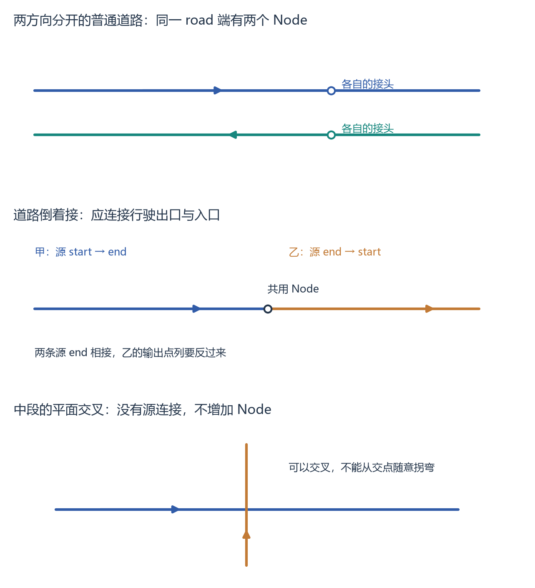

两个方向分别建节点；按行驶出口接入口；无连接声明的中段交点不建节点。

### 4.2. 很近的端点，以及明确声明相接的端点

当前合并节点有两种依据：

1. **坐标很近。** 默认平面距离不超过 0.05 m，同时检查高程差，避免桥上、桥下因 XY 重合被吸附。
2. **源数据明确相接。** 根据 road 的 predecessor、successor 和对方 contactPoint 配对，有效方向的出口接入口。

源连接按声明配对，可以合并相距较远的端点，但仍需复核代表位置和迁移量。坐标吸附默认要求高程差不超过 max(snap, 0.1 m)；输出只保存 XY，高程检查只用于避免错误吸附。

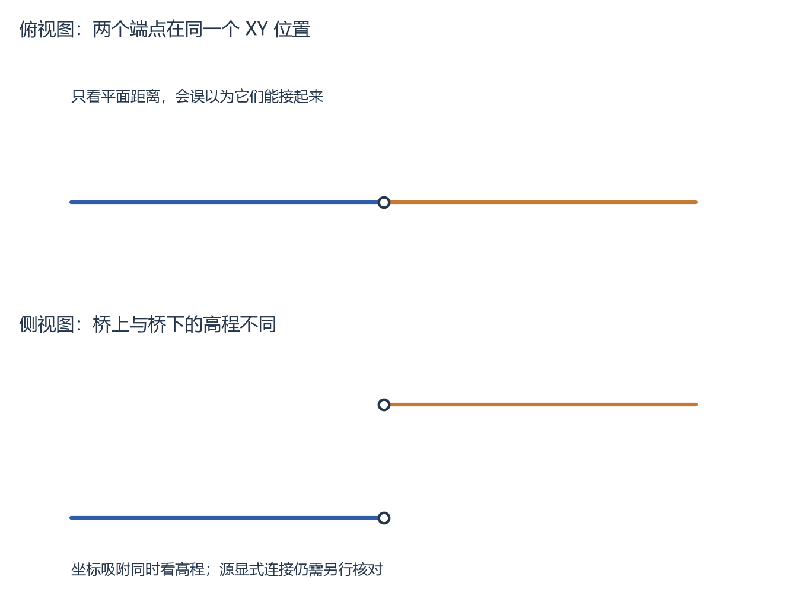

平面位置相同、高程不同的端点，不应仅按距离吸附。

源终点接对方起点时，内部里程方向符号相同；接对方终点时，对方符号相反。两种情况都按行驶出口接入口处理。

### 4.3. 节点位置优先沿用普通道路的节点

路口连接线常从某一条具体车道出发，而主 Link 表示整个车道群。两者的源端点自然会差半个车道宽，宽干道上甚至会差几米。

把连接线端点混入节点均值，会把主路末点拖向转弯线，造成直路临近路口时突然偏折。

同一合并组中，优先用普通 road 端点的平均位置确定 Node；没有普通 road 时，才平均连接路端点，再调整线头接入节点。

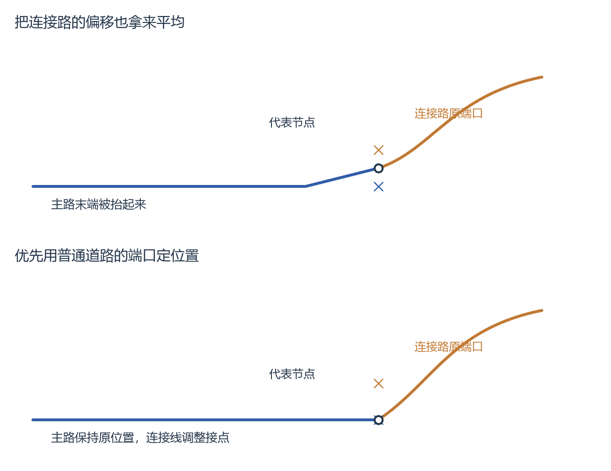

叉号为原端点，圆点为合并后的节点。下图优先采用普通道路位置。

普通 road 端点也可能有差异，合并后仍可能移动。spread 记录合并组内原端点到代表节点的最大距离；snap_m 记录 Link 原端点的最大迁移量。

## 5. 辅道渐变

### 5.1. 什么情况下需要拆一条 aux

进口道常见“三车道变两车道”：最外侧车道逐渐收窄到零。反过来，从零逐渐变宽，则可能形成分流车道。

渐变车道参与取中位数，会把主组代表线带偏。因此先分出符合条件的渐变车道，用稳定车道计算主组；是否另出 aux，再看它有没有独立接点和后续路径。

拆分有三个条件：车道沿整个 road 都有定义；宽度既有小于 0.4 m 的位置，也有大于 0.5 m 的位置；位于稳定车道群的边缘。这些阈值是处理参数，不是道路设计标准。

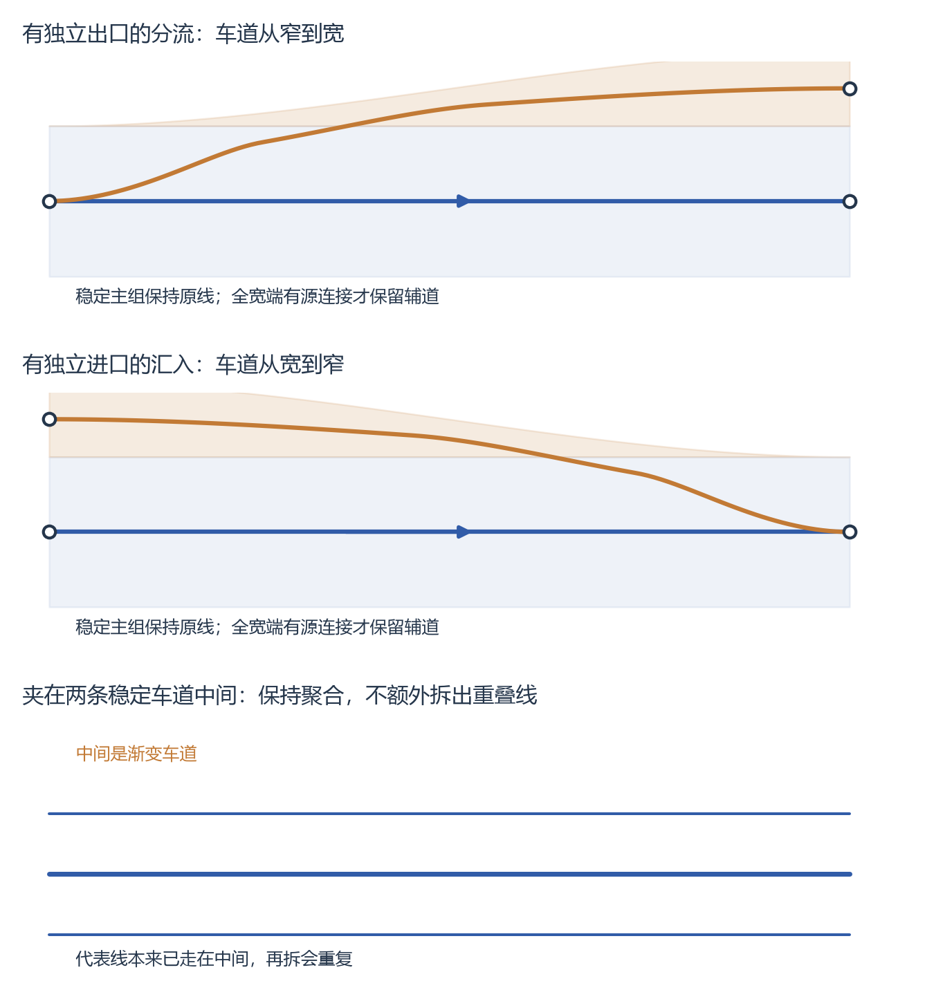

橙线为辅道，蓝线为主组，夹在稳定车道之间的渐变车道不拆分。

只在某个 laneSection 出现的车道，当前不把它拆成独立的整 road 辅道。因为这里的节点主要建在 road 两端，直接拆出中途起终的车道会造成没有正确接头的短支线。

### 5.2. 辅道两端都回到主组，就只保留主组线

渐变辅道若与主组共用起终节点，两条线都只表达 A→B，没有独立出口。此时保留原主组，省略辅道 Link。**主组仍按稳定车道计算，不能把渐变车道加回来重新取中位线。**

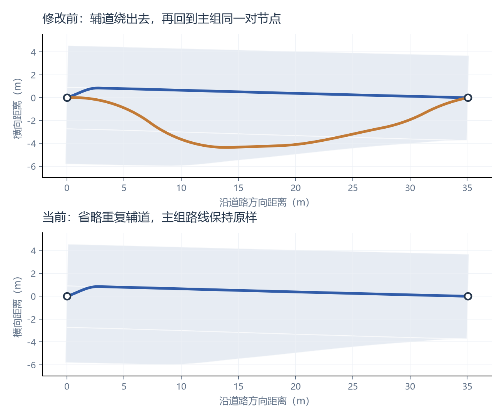

上图辅道与主组共用起终节点；下图省略辅道，主组位置不变。

代码先完成车道分组、节点配对和线形整理，再检查每条普通 aux：同一 road 内有唯一主组，起点、终点及通行方向一致，才省略它。不同 road 的平行线、连接不同节点的辅道，以及路口里的转弯、掉头，都不属于这类重复边。

### 5.3. 收窄端接主组，全宽端还要看源连接

线分开以后，节点不能继续无条件共用：

- 收窄端用主组节点，表达汇入或分流。
- 全宽端有 lane/link 或 junction/laneLink 接到独立路径时，保留辅道自身节点。
- 没有独立连接依据、两端都回到主组时，省略 aux，保留稳定主组；不能只因两条线隔得远，就新建一条通行关系。

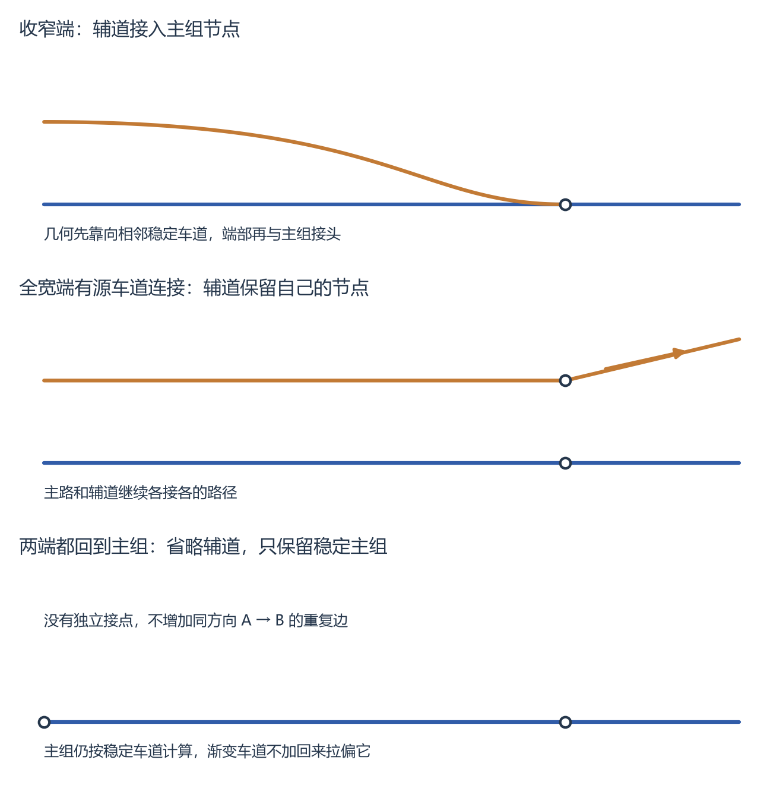

有独立连接时保留辅道节点；两端都回主组时省略辅道。

保留的辅道在全宽处走自身中心线，收窄时逐渐靠向紧邻的稳定车道中心，再接主组节点。这个过渡目标不一定是整个主组的中位线。

Town06 的例子中，源连接车道 −1 明确接到辅道 −3，两条线的自然端点相接；主组端点在下方，相差约 8.775 m。

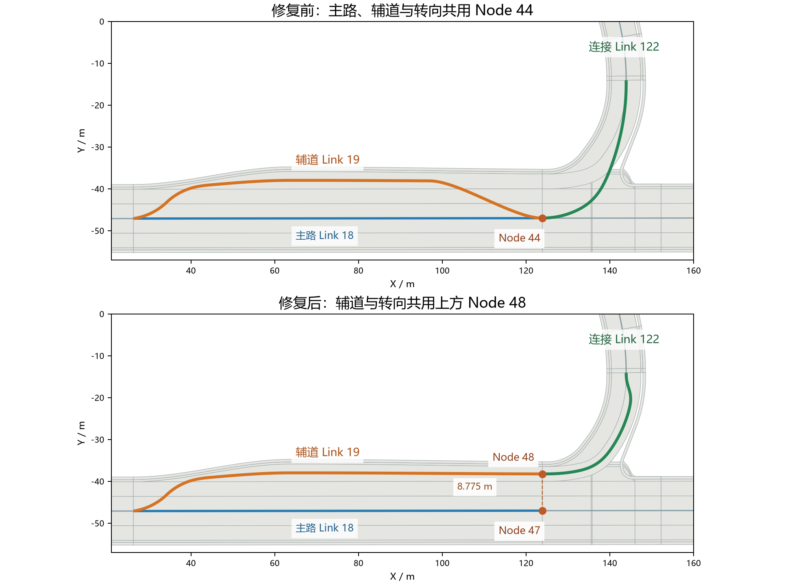

上图误接主组；下图 Link 19、122 共用 Node 48，主组使用 Node 47。

### 5.4. 一条连接路里同时接主路和辅道，不能只保留一组

一条 connecting road 可能同时接主组和辅道。只保留一条代表线会漏掉路径；让两组共用入口又可能接错组。

处理时沿每条车道的 lane/link 追踪跨段编号，再按两端各属于哪个车道组归类。主组→主组、辅道→主组、主组→辅道分别保留，之后才能判断哪些平行转向可以合并。

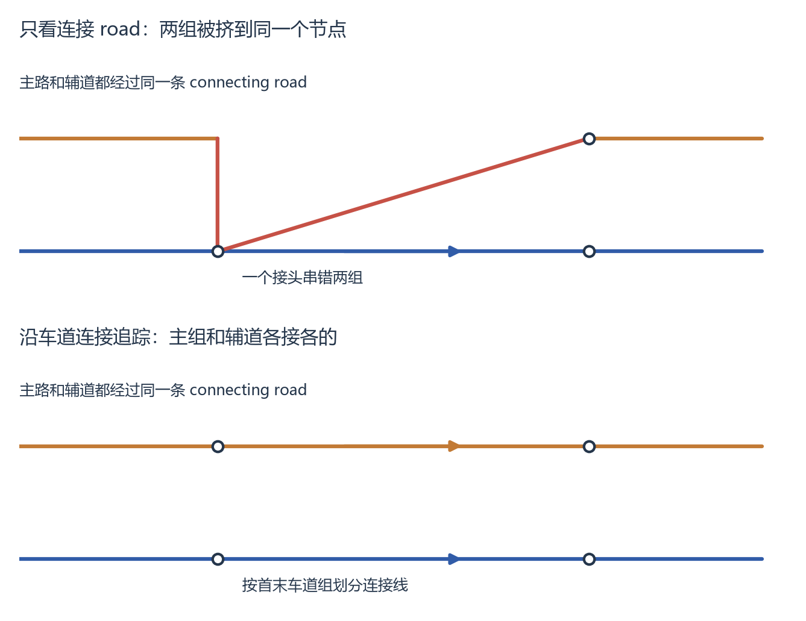

上图两组挤在同一接头；下图按车道来源分组，各接对应节点。

### 5.5. 收窄端接线穿过主组，也要单独处理

全宽端拆开后，收窄端仍可能因为追主组节点而多穿过主线一次。只有确认源辅道并未穿过主组、而端点处理新增了穿越时，才沿主组局部方向重做最后一段过渡。

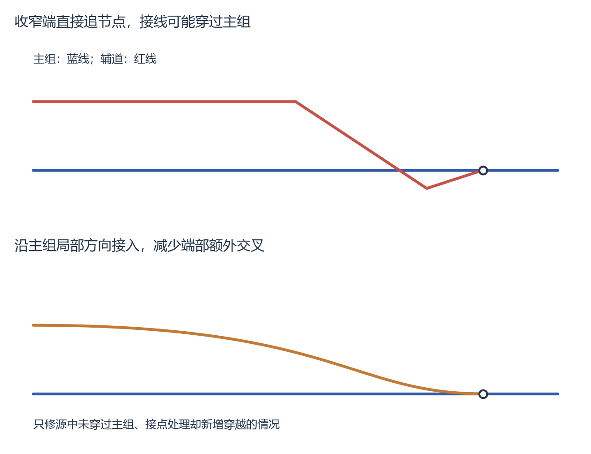

沿主组方向调整接头，消除额外交叉，节点位置不变。

## 6. 曲线连接

### 6.1. 曲线函数选择

Node 的位置确定后，代表线要接到这些节点。先介绍常用曲线方法，再看接头案例。

局部接头和整段转弯使用不同方法。整段转弯优先沿源弧分摊节点位移，再按配置平滑；不合适时，才尝试首末方向受控的三次贝塞尔。

#### 6.1.1. 不同位置，使用不同的曲线方法

| 处理位置和情况                 | 使用的方法             | 代码中的函数                          | 调整范围                      |
| ----------------------- | ----------------- | ------------------------------- | ------------------------- |
| 端点以横向偏移为主，且有足够过渡空间      | 两段方向相反的圆弧         | `_s_merge()`                    | 回退后的一段接头，见 6.2            |
| 大横移放不下双圆弧，或小偏移形成末段折角    | 首末方向受控的三次贝塞尔      | `_tail_blend()`、`_tail_soft()`  | 限定的端部区间，见 6.3、6.4         |
| 补线或贴线接缝处的局部折角           | 二次贝塞尔过渡           | `_fillet_at()`                  | 接缝两侧的小段                   |
| 普通连接线的小起伏，以及节点位移造成的整段回摆 | 三阶平滑权重分摊位移，结合高斯平滑 | `_smoothstep()`、`smooth_line()` | 符合条件的源曲线；高斯平滑先均匀重采样，见 6.6 |
| 常规单次转弯，沿源弧分摊后仍不满足条件     | 首末切向受约束的三次贝塞尔拟合   | `_fit_turn()`                   | 整条转弯连接线                   |
| 已确认的掉头                  | 沿源回转弧分摊节点位移       | `align_uturn_to_nodes()`        | 保留回转形状，另按第 10 节检查         |

双圆弧按偏移和可用空间计算半径；局部贝塞尔按接点、方向和回退距离设置控制点；高斯平滑对等距点列加权平均。整段转弯的 `_fit_turn()` 才求最小二乘拟合参数。

#### 6.1.2. 双圆弧：横移后回到原来的行驶方向

双圆弧先向侧面偏，再把方向转回来，接到侧面的节点。图中两段半径、长度相同，首末方向平行，拼接处方向连续。

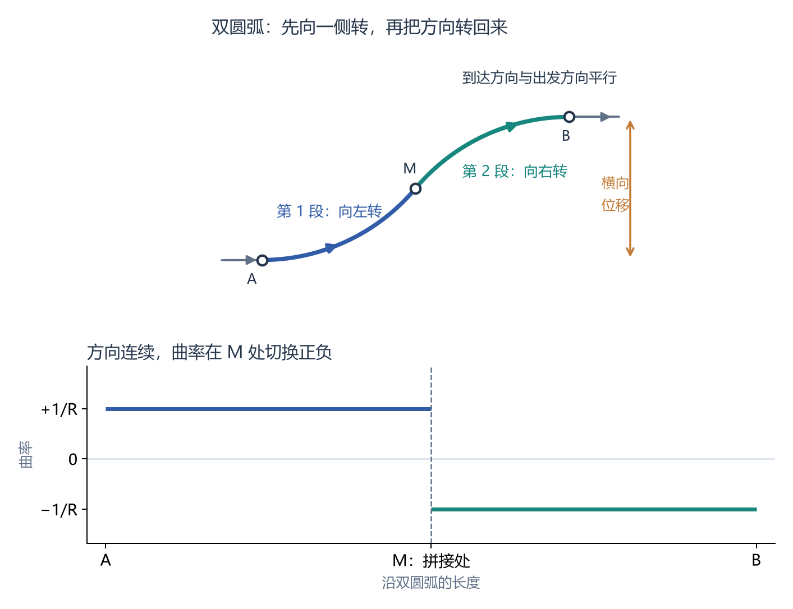

蓝弧向左转，绿弧向右转；M 为拼接处，R 为半径，下图展示曲率变化。

`_s_merge()` 根据横向位移和可用的前进距离计算半径与回退位置，适合有足够空间的横移，见 6.2。拼接处方向连续，但曲率会切换正负，因此只作为道路级接头过渡。

#### 6.1.3. 二次贝塞尔：用一个控制点磨平局部折角

二次贝塞尔有两个端点和一个控制点。处理局部折角时，在折点两侧各退一小段作端点，原折点作控制点：

$$
Q(u)=(1-u)^2P_0+2(1-u)uP_1+u^2P_2,\qquad 0\le u\le1
$$

曲线从 P0 朝 P1 出发，沿 P1→P2 的方向到达 P2。`_fillet_at()` 用它磨平接缝，其他源线保留。

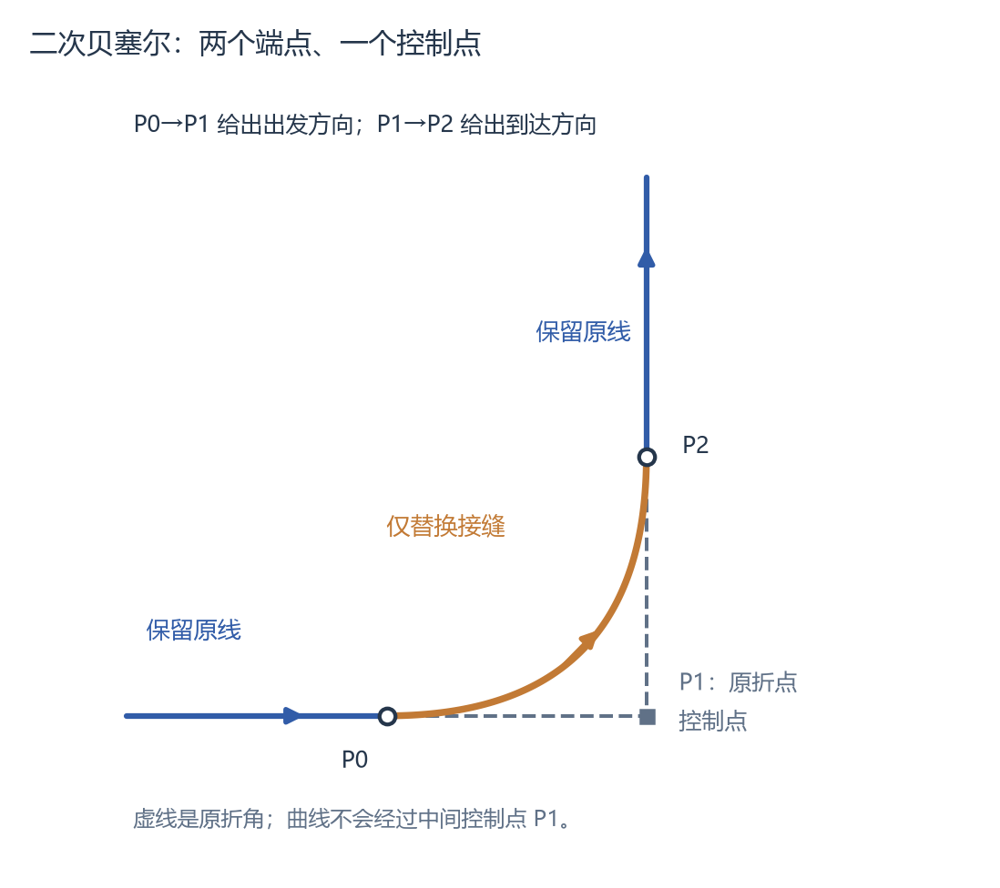

灰虚线为原折角，橙线为过渡，蓝线保留；P0、P2 是端点，P1 是控制点。

#### 6.1.4. 三阶平滑权重：把节点位移沿源弧分摊

设源车道群中线为 $p(u)$，$u$ 是已走弧长占总弧长的比例，取 0～1，与参考线里程 s 不同。

源首末点到目标 Node 的位移分别为 $\Delta_A$、$\Delta_B$。代码用三阶平滑权重分配这两个位移：

$$
w(u)=3u^2-2u^3
$$

$$
q(u)=p(u)+[1-w(u)]\Delta_A+w(u)\Delta_B
$$

起点、终点分别加上各自位移，中间逐渐过渡。权重在两端的导数为零，位移变化平缓，有助于保留源转弯形状。

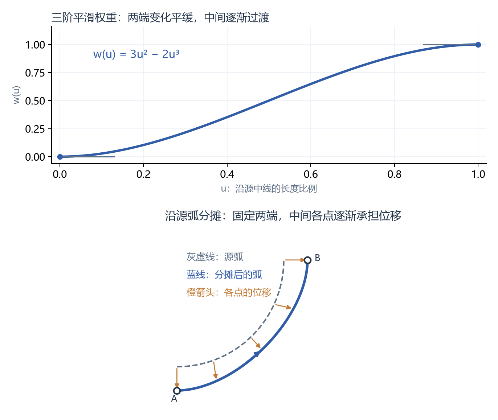

上图为位移权重；下图灰线为源弧，蓝线为位移分摊结果，A、B 固定，尚未平滑。

#### 6.1.5. 高斯平滑：让附近的点共同影响小起伏

高斯平滑先按弧长均匀重采样，再给每个点附近的坐标分配权重。沿线距离 d 越小，权重越大；距离越远，影响越弱。权重函数为：

$$
G(d)=\exp\left(-\frac{d^2}{2\sigma^2}\right)
$$

各权重先除以总和，再分别对 x、y 坐标加权平均。`sigma`（σ）以米为单位，控制平滑范围。σ 越大，局部起伏越弱，但也可能改变弧形，因此需限定对象并固定两端。

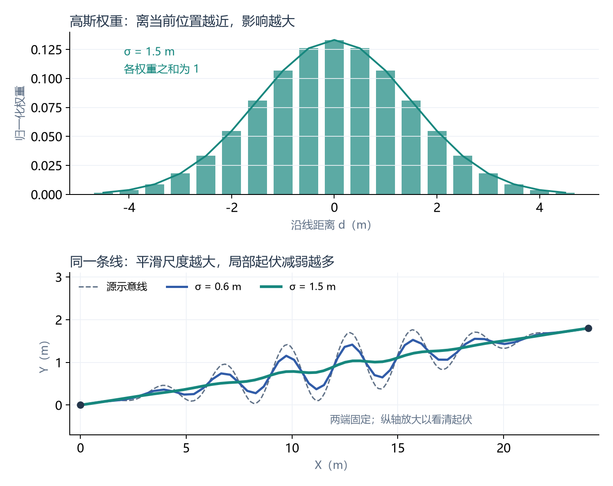

上图为高斯权重；下图比较两种平滑尺度，两端位置固定。

沿源弧分摊位移后，默认以 σ=1.5 m 做高斯平滑，重采样和端点补偿见 6.6。σ 表示平滑范围，不是转弯半径；掉头另用专门的源弧对齐。

#### 6.1.6. 三次贝塞尔：分别约束入口和出口方向

三次贝塞尔由四个点决定：两个端点 $P_0$、$P_3$，以及两个控制点 $P_1$、$P_2$。参数曲线同时给出 x、y 坐标：

$$
B(u)=(1-u)^3P_0+3(1-u)^2uP_1+3(1-u)u^2P_2+u^3P_3,
\qquad 0\le u\le1
$$

这里的 $u$ 是贝塞尔参数，不等于曲线自身的弧长比例；拟合时按源中线的归一化弧长配对目标点。

端点取两个 Node。入口方向 $t_{in}$、出口方向 $t_{out}$ 来自顺向连接的前后普通 road，两个向量均归一化。控制点按这两个方向放置：

$$
P_0=A,\quad P_1=A+h_{in}t_{in},\quad
P_2=B-h_{out}t_{out},\quad P_3=B
$$

曲线从 A 沿入口方向出发，沿出口方向到达 B。端点和方向固定，只求控制臂长度 $h_{in}$、$h_{out}$，决定转弯展开程度。

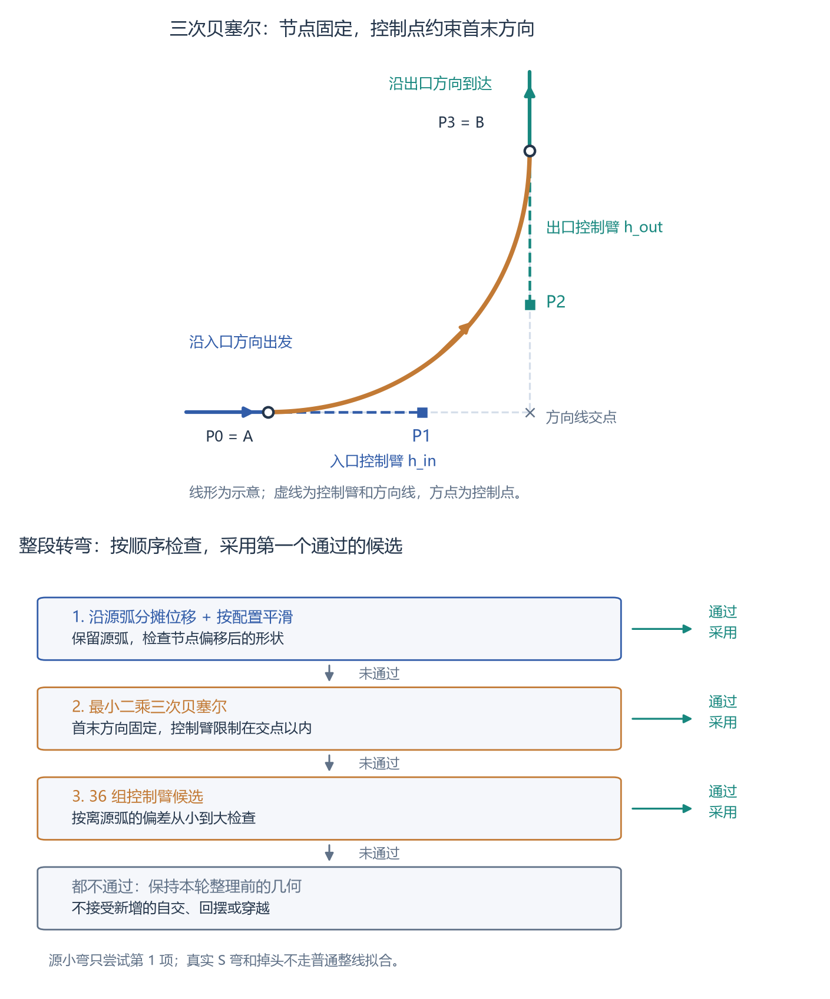

上图展示控制点和首末方向；下图展示尝试顺序，通过检查才采用。

`_fit_turn()` 先按约 0.5 m 间距重采样源中线，再分摊两端位移，作为拟合目标。随后用 `numpy.linalg.lstsq()` 求控制臂长度，使贝塞尔采样点尽量靠近目标。

控制臂还受空间限制：从 A 沿入口方向向前延长，从 B 沿出口方向向后延长，两条射线必须相交。平行、近似平行或交点在射线反方向时，不生成候选。设两端到交点的距离为 $D_{in}$、$D_{out}$，**先求最小二乘解，再把各控制臂限制到对应距离的 20%～85%**。

#### 6.1.7. 候选顺序和拒绝条件

整段转弯的 `_refine_connectors()` 按下表尝试，采用第一个通过检查的候选：

|   顺序 | 候选             | 如何选择                                     |
| ---: | -------------- | ---------------------------------------- |
|    1 | 沿源弧分摊位移，再按配置平滑 | 先检查能否保留源形状并消除回摆；通过就采用                    |
|    2 | 最小二乘三次贝塞尔      | 使用首末方向和受限控制臂，检查整段转弯                      |
|    3 | 有限组控制臂的三次贝塞尔   | 两端分别在 20%～85% 范围取 6 个比例，组合成 36 个候选；按离源弧的偏差从小到大检查 |
| 都不通过 | 保持本轮整理前的几何     | 不为消除一个凸起接受新的自交、回摆或穿越                     |

整线处理只用于源小弯或常规单次转弯。常规转弯要求进出方向夹角为 15°～135°，源弧总体转向接近该夹角，累计反向转角不超过 5°；相邻 road 与源端部方向偏差不超过 10°。源小弯只尝试分摊位移；真实 S 弯、变道、掉头和自交源线不进入常规拟合。

通过形状分类后，还要满足这些条件：

- **位移不能过大。** 普通整线整理的最大节点迁移不超过源弧长的 40%；掉头另走专门对齐流程。
- **偏离和长度有界。** 候选离源弧的最大偏差不超过 `max(2×实际端点迁移量, 0.5 m)`，长度应为源弧长的 75%～140%。这里的偏差按 Hausdorff 距离比较，也就是两条线彼此最远的偏离。
- **仍然是原来的转弯。** 不能增加明显反向回摆，首末点必须严格对应 Node，候选无自交、坐标有限，全部内部折角不超过 25°。
- **不能产生无来源的穿越。** 普通转弯替换不得增加与其他 Link 的内部穿越次数；联合候选使用整组修改前确定的次数上限，不能把临时生成的交叉当作已经存在。

候选按源形状、进出方向、可用空间和检查结果选择。局部接头另有窗口、曲率和偏离限制，不能套用整线阈值。

### 6.2. 先看节点在前方、侧方，还是原线头后方

下面以行驶终点为例，“前方”和“后方”都按车辆行驶方向判断。目标 Node 在原线头前方，可以顺着方向补长；Node 在侧方，需要在末段逐渐横移，直接横着补会出现直角钩。

半个车道宽的横移很常见：主组中线位于两条车道之间，而单车道转向的源端点位于其中一条车道中心，两者差 1.75 m。

还有一种情况：目标 Node 在原末点 P 的后方。保留原线走到 P，再从 P 接回 Node，车辆就会先越过节点再往回走。对于有足够端部空间的小偏移，可以这样调整：

1. 在原线上选一个更早的 F 点，保证从 F 到 Node 仍沿行驶方向向前。
2. 去掉 F 之后的旧末段，包括已经越过节点的 P。
3. 从 F 接入 Node。两者共线时可截短；带少量横向偏移时，用浅的三次贝塞尔过渡。

这里的回退发生在生成几何时，车辆始终沿 F→Node 向前到达。F 是改线的起点，路网不增加 Node。

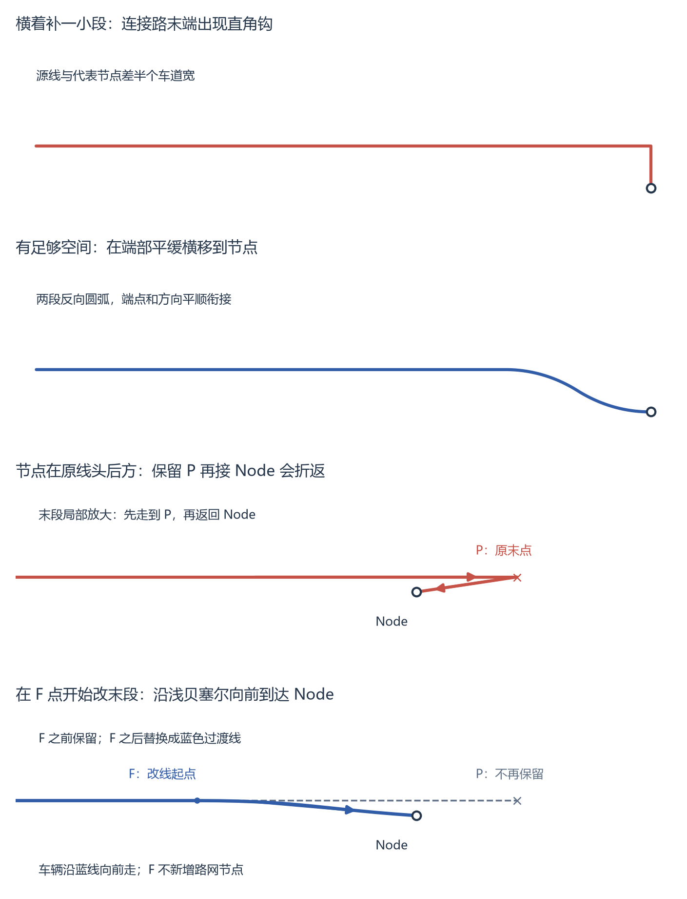

上两幅比较横补和双圆弧；下两幅比较经 P 折返与从 F 向前接入节点。灰线为旧末段。

`_tail_soft()` 从原末点回退到 F，用三次贝塞尔替换旧末段，保留 F 之前的源线。默认调整距离不超过 1.2 m，还需检查空间、方向、曲率和偏离，见 6.4。

条件不满足时，代码可能直接把末点改为 Node。如果倒数第二点已越过 Node，末段仍会折返，需复核末段折角和节点位置。

横移较大、放不下双圆弧时，见 6.3；线太短或调整距离超过源线总长时，见 6.5。先解决折返，再磨平局部接缝。

### 6.3. 横移几米的宽路口，局部曲线过渡更合适

实例中 Road 4452 的右转从最外车道出发，与车道群代表节点横向相差约 6.19 m。双圆弧需要的前进空间较大，但源线很快就开始转弯，无法放下合适的过渡。

这里用三次贝塞尔替换局部接头，让线从节点沿道路方向出发，再平顺接回源弧。

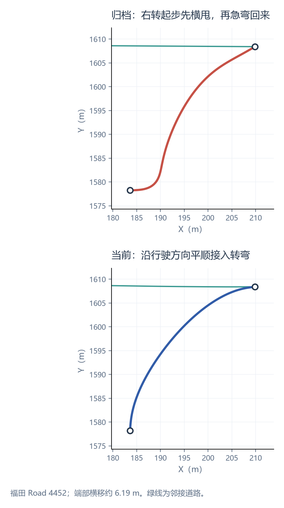

旧接头先横甩再拐回；当前沿道路方向接入源弧。绿线为邻接道路。

处理只替换端部，并限制回头、曲率和源偏离。大横移过渡每条线只选一端，避免两端各占较长区间，把短转弯的中段一起拉成斜线。

### 6.4. 不到一米的偏移，也可能留下很大的折角

位移小于采样步长，也可能造成明显折角。用浅的端部过渡把位移分摊到最后几米，保留更早的源线。

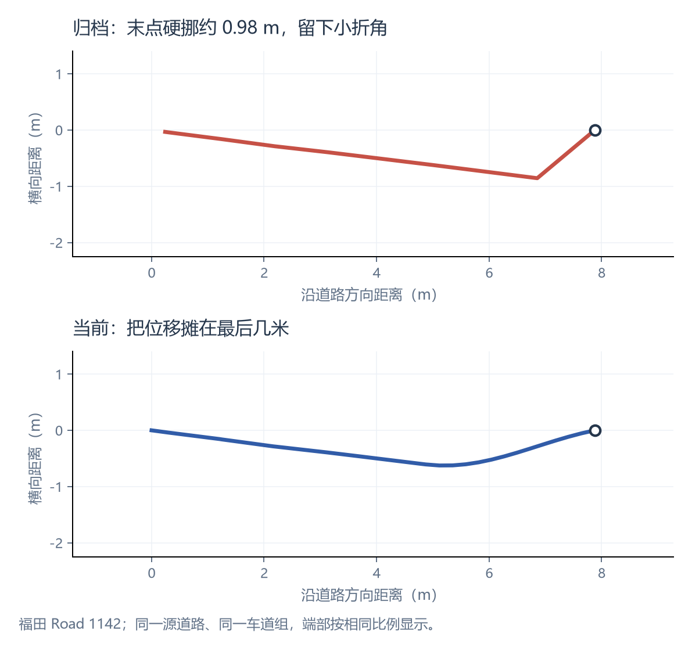

上图硬挪末点，下图平顺接入。圆点为节点，另一端只是截取边界。

最后一段若只有 1 cm，末点横挪 2 cm 就会造成大折角。因此还要检查末段夹角，不能只看位移大小。

### 6.5. 极短线既不能随便删，也不能两头乱补

Town03 的 Road 51、81，源长度只有约 0.38 m、0.46 m。它们在图上很不起眼，却可能是两段道路之间的接头。把最小长度门槛提高到半米，会把有效连接过滤掉。

还有一种情况：源连接线只有几十厘米长，但它的两端要接到车道组的代表节点，线头可能需要挪动一米甚至更多。这里的“线头调整距离”，指原起点到起点 Node、原终点到终点 Node 各自的距离。

例如，沿同一条直线量取位置，原线从 P（0 m）走到 Q（0.4 m），只有 0.4 m 长；最终路网要求它连接 A（1 m）和 B（2 m）：

```text
原线：         P（0）→ Q（0.4）
保留原线再补两头：A（1）→ P（0）→ Q（0.4）→ B（2）
当前简化接头：   A（1）→ B（2）
```

第二行会先从 1 m 处退回 0 m 处，再往前走，形成补线带来的折返。代码在任一端的调整距离大于原线总长时，直接用 A→B 的直线表达接头，保持原有连接关系。

本例两端分别调整 1 m、1.6 m，`snap_m=1.6` 记录较大值，便于复核。节点间直线是道路级简化；已确认的掉头仍保留回转弧。

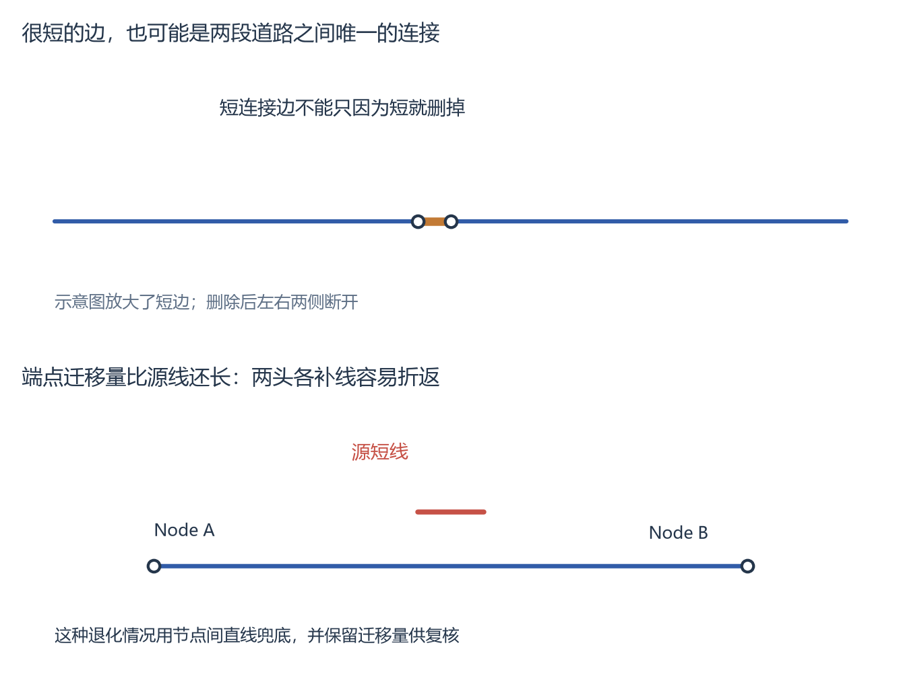

上图短接头不能删除；下图红线为源短线，蓝线直接连接 A、B。下图与数值例子位置不同。

重复采样点会先去掉；不足两个不同点的线不写出，默认最小 Link 长度为 0.1 m，仍要结合源数据检查过滤是否影响连通。

### 6.6. 平滑前先让点距均匀，平滑时固定两端

不同源几何的采样点距可能很不均匀。如果直接把相邻几个顶点做平均，点密的地方和点疏的地方会得到不同强度的处理。

连接线先按弧长均匀重采样，再以米为尺度平滑。两端做延展和偏移补偿，最后强制保持原端点。否则线形变顺了，节点接头却又松开了。

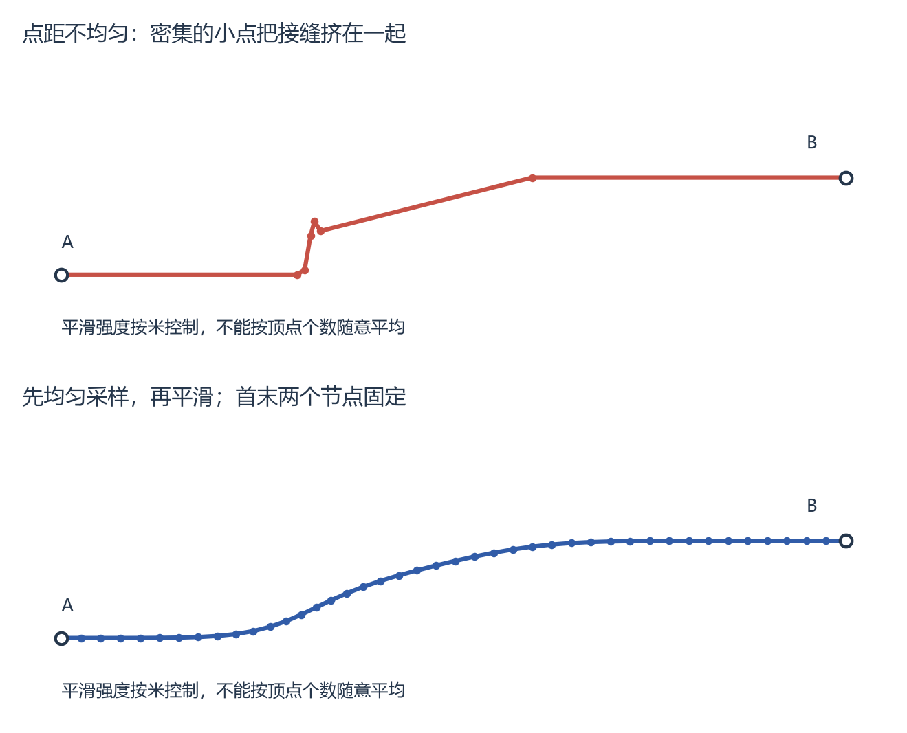

先均匀重采样，再平滑；A、B 两端固定。

默认整线高斯平滑只用于 connector；主路仍可能做端点对齐。急弯、重复点和极短段需单独处理，不能只加大平滑强度。

## 7. 合流斜穿和环岛切角处理

### 7.1. 合流线末端斜穿，可以沿邻线接到同一节点

有些连接路落在外侧车道，而终点 Node 代表整个车道群。连接线为了接到节点，末端先斜穿同节点的另一条代表线，再拐回来。

在限定端部窗口内找到真实交点，从交点起沿邻线接到共同节点，统一接缝坐标，必要时加局部圆角或平滑。

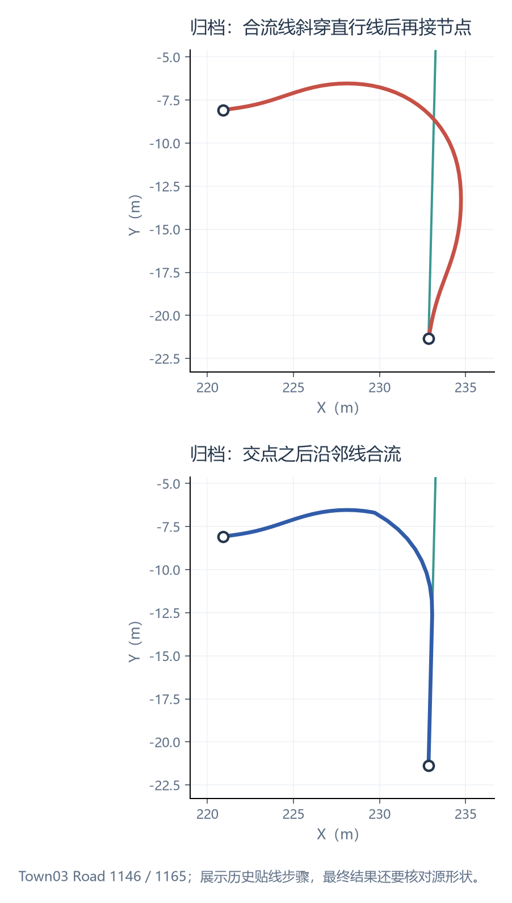

Town03 Road 1146、1165 的归档阶段对比：交点后沿邻线合流，后续还需整理线形。

只处理靠近端部、从邻线一侧穿到另一侧的交点，并保留足够的自身路径。共同 Node、相切和搭接不算穿越，贴线后两条 Link 仍是不同的有向边，重合起点不自动增加 Node，也不表示可以换路。

### 7.2. 合流接缝很陡，圆角之后还要检查

邻线也在弯、接缝夹角较大时，小圆角仍可能留下折角，Town04 Road 1162 就出现过这种情况。

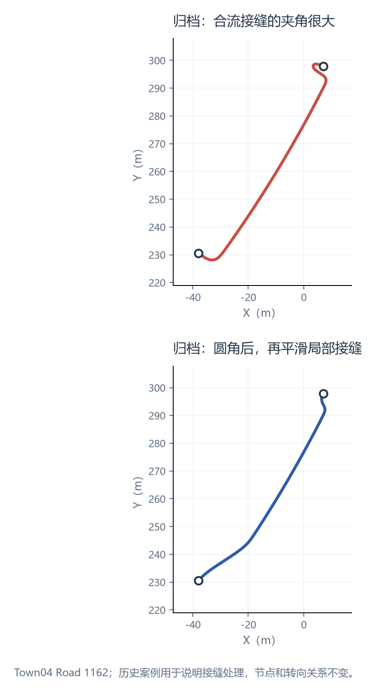

圆角后仍有折角时，只平滑接缝附近的小段，两端固定。

检查时区分源中已有交叉和接头新增交叉，通行关系仍以源连接为准。

### 7.3. 环岛里钻进环道再切出来，要看中段

Town03 Road 1608 曾在中段穿入 Road 1624 的环道，再斜着切出来，两个交点离端点都远，端部窗口处理不到。

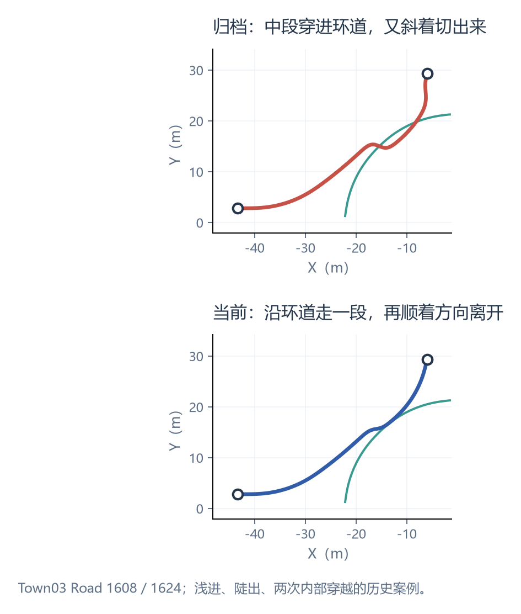

上图 Road 1608 中段切角；下图沿绿色环道线接出

两次相交还不够。入口交角需较小，出口交角较大，中段偏离较浅，沿环道的距离和两线终点间距也要受限。满足这些条件，才沿环道走一段，再用方向受控的曲线接出。

车道数变化会改变中位线位置，也可能造成这种切角。处理只针对符合条件的局部代表线，真实交叉和 S 弯保留。

## 8. 直行鼓包与转弯凸起处理

### 8.1. 直行先看源车道群，再看前后道路

两端移到节点、中段仍沿源线走，可能形成鼓包。Town03 Road 1426 是一例：原 Link 244 在补入路肩掉头后重编号为 Link 245。

拉直需同时满足：源车道群中线近似直线，前后 road 顺向连接，两侧局部方向接近节点间直线。

不能只看 planView 是 line。参考线是直线，车道宽度或 laneOffset 变化，车道中线仍可能弯。

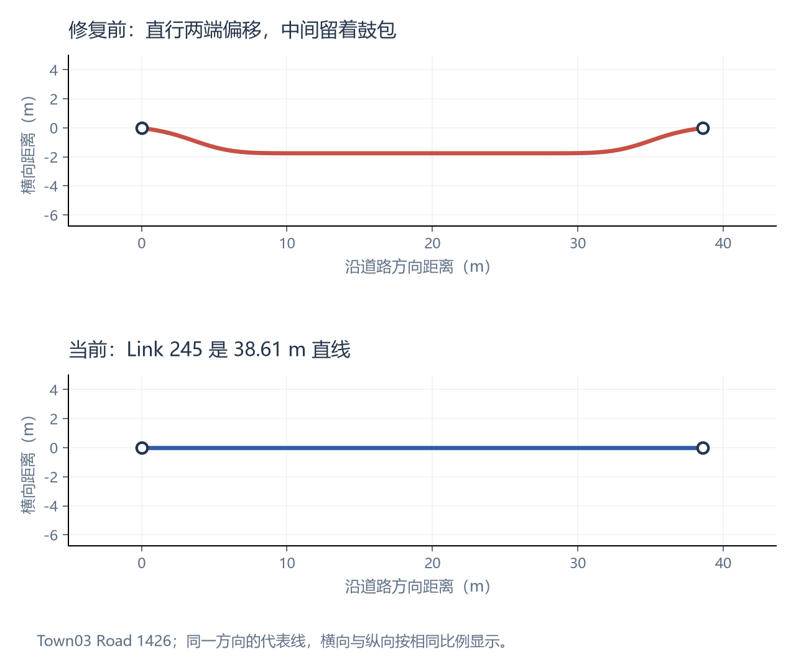

### 8.2. 直行和相邻转弯一起调整

Town10HD 的 Link 86 单独拉直会穿过 Link 90 的末段，因为转弯线也在接节点时变形，需要一起调整。

先看图中三条线的关系：

| 图中的线                   | 源 road | 路径关系                            |
| ---------------------- | ------ | ------------------------------- |
| 直行 Link 86，修改前红色、拉直后蓝色 | 736    | Node 70→72                      |
| 绿色转出线 Link 88          | 795    | 与 Link 86 共用起点 Node 70，再转向另一出口  |
| 橙色转入线 Link 90          | 832    | 从另一个进口转入，与 Link 86 共用终点 Node 72 |

Road 736 的源车道中线是 46.15 m 的直线，两端距前后道路的车道组节点各 1.75 m。旧处理只在两头补过渡，中间仍沿源线走，形成红色鼓包。

橙色 Link 90 接到 Node 72 前，先越过理想直行线约 6 cm，再拐回节点。红色鼓包还在时，两线不交叉；改成蓝色直线后，就会穿过这段凸起。

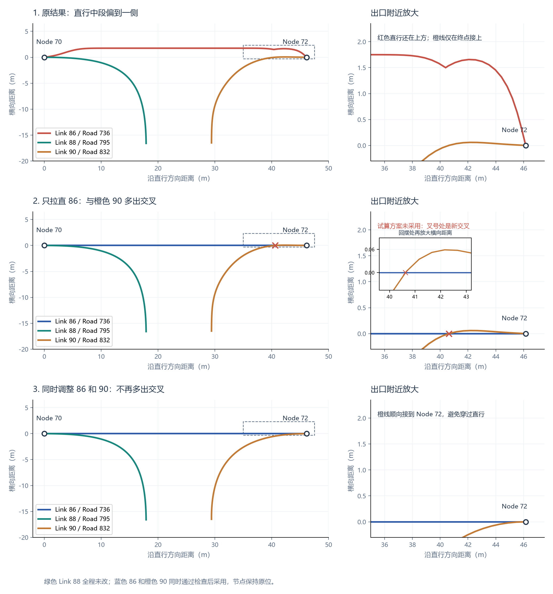

上、中、下依次为旧结果、单独拉直和共同调整。叉号为新增交点，圆点为节点。

在 Node 72 相接是正常接头；**节点之前的交叉在源中不存在**，因此不能只拉直 Link 86。

处理分三步：

1. **试拉直，找出阻挡线。**直接连接 Node 70、72，检查新增交叉。本例只有橙色 Link 90 阻挡，绿色 Link 88 保留。
2. **共同调整。**Link 86 用节点间直线；Link 90 固定起终节点，按源弧重新计算转弯，平顺接入 Node 72。曲线方法见 6.1 和下一节。
3. **整组检查后保存。**核对两线及周边线的交叉、端点、方向、长度和弯形。不能把试算新增的交叉当作已有交叉；任一项不通过，就放弃整组。

最终 Link 86 为 46.15 m 直线，Link 90 消除回摆。节点和原有通行关系保留。

### 8.3. 右转线多摆了一下，怎样去掉凸起

Town03 Link 181 对应 Road 817，车辆从图下方驶入，再右转到出口。源中线只有一次右转；旧结果先斜向右，再向左修正，最后继续右转，多了一次左右摆动。

源起点与车道组 Node 横向相差 3.5 m。旧处理在入口补一段过渡，从节点接回源弧；两段虽然各自平滑，拼成整条转弯后却多出摆动。

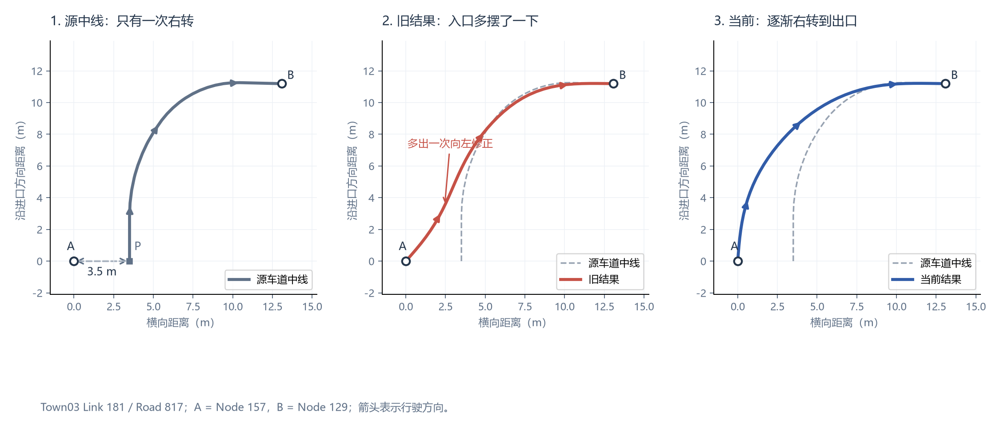

左为源线，中为旧结果，右为当前结果。A、B 为固定节点，灰虚线为源线。

确认源中只有一次右转后，按以下顺序处理：

1. **沿整条源弧分摊横移。**起点横移 3.5 m，向终点逐渐减到零，再按配置平滑。本例采用这个方法，权重见 6.1.4。
2. **不合适时，再试三次贝塞尔。**连接 A、B，首末方向沿进出口道路，中间尽量贴近源弧，方法见 6.1.6、6.1.7。
3. **检查后替换。**核对源偏离、长度、折角、自交和周边交叉。所有方法都不通过，就保留整理前的线形。

蓝线逐渐右转到 B，消除了入口摆动。左转按相反方向检查，接头接上后，还要检查整条转弯是否变形。整线调整需满足 6.1.7 的条件；真实 S 弯、变道和掉头见下一节及第 10 节。

### 8.4. 真实 S 弯、变道、掉头，要保留

首尾方向一致，不代表中段一定该直；转弯半径小，也不代表末端接错了。处理前先核对源轨迹，区分真实的 S 弯、车道变换、掉头、环岛弧和接头造成的变形。

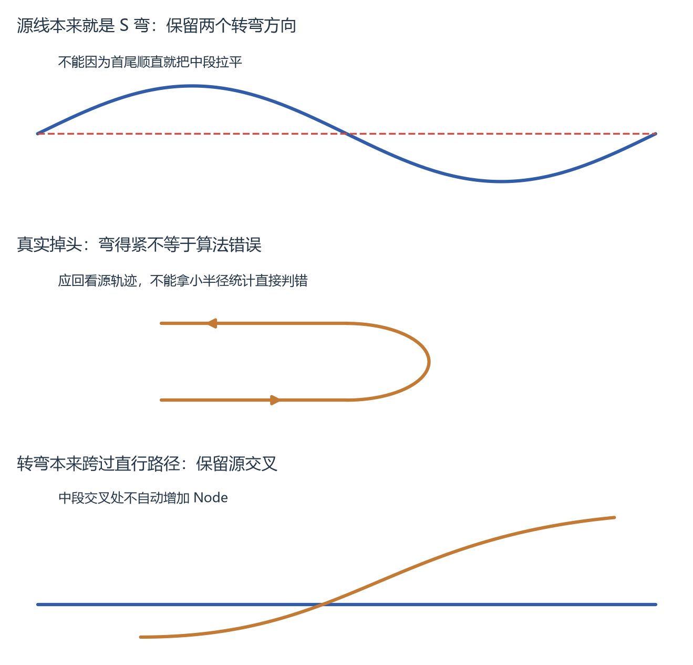

红虚线示意错误拉直；真实 S 弯、掉头和正常交叉应保留。

真实 S 弯、掉头、自交源线和过大节点迁移不进入常规整线拟合。必要时仍会调整局部接头，输出是道路级概括，不等于完整还原源轨迹。


## 9. connection合并

### 9.1. 先看起终节点是否完全相同

一个路口转向常被拆成几条 connecting road，对应不同的车道配对。车辆从同一个入口 Node 到同一个出口 Node，在道路级图里可以用一条代表线表达。

先区分普通转向和掉头，再各自按 (junction_id, from_node, to_node) 分组，选中间一条作为代表。曲线长度和转弯进度不同，逐点平均容易生成源里没有的轨迹。

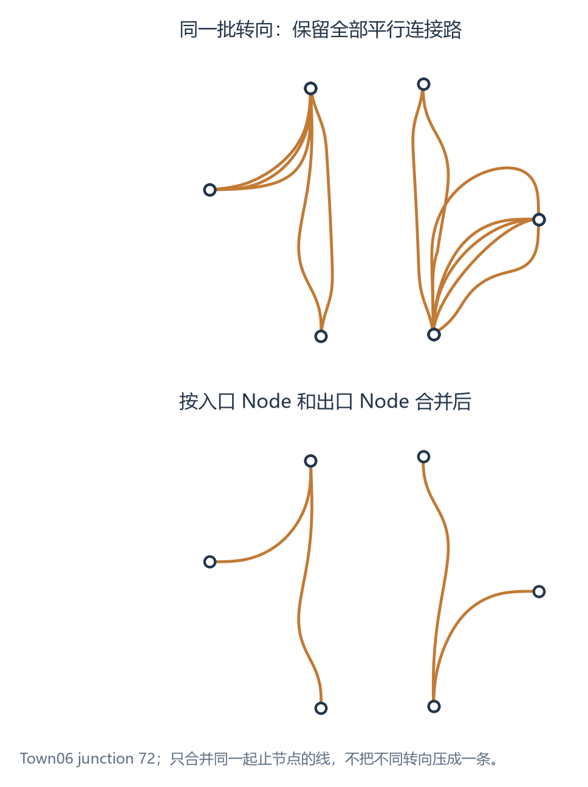

Town06 junction 72 合并前后：只合并同起终节点的平行路径。

主组和辅道的节点必须先分清，否则原本接入不同车道组的线，会被错误地认为是“同一个转向”。

### 9.2. 属性保留

合并保留 Node 间的道路级可达关系，减少逐车道细节。n_merged 记录省略数量，值为 4 表示原有五条，保留一条。

lanes 取这批连接组的最大车道数，不简单相加。road_id、lane_ids、限速等来自保留下来的代表记录，**不是被省略的全部车道来源清单**。需要完整车道路径和属性时，应保留 JunctionLink，或关闭转向合并。

内部仍保留全部源 connection、laneLink 引用，用来追踪合并关系。

## 10. 掉头连线

掉头 Link 让车辆从进口进入路口，再接到反向出口。两条反向道路相距很近，也需要明确的连接路径才能通行。

### 10.1. OpenDRIVE 掉头表达

普通路口中，掉头与左转、右转一样，由 connecting road 和车道连接表达。junction 默认类型为 default，connection 给出进口、连接路和车道配对，没有专门的 type="uturn" 声明。

可以把一条路径拆成三段看：

**进口 road 上的车道 → connecting road 上的车道 → 反向出口 road 上的车道。**

connecting road 也有参考线、车道宽度和中线。几何给出回转弧，连接声明给出进出口；只有 U 形线，不能证明路径可通行。

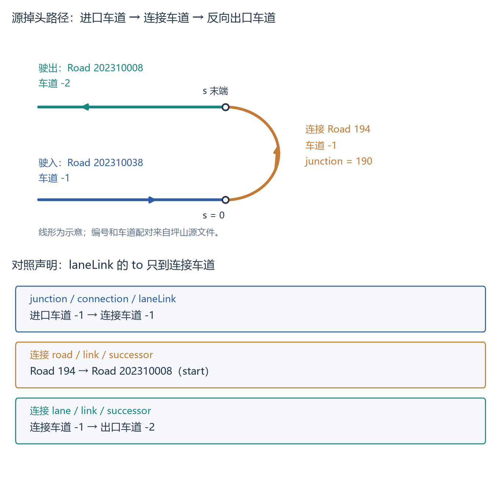

实例 junction 190：laneLink 配进口车道，连接车道的 successor 配出口车道。

下面摘录这条路径的连接声明，省略几何和宽度，**不是完整 XODR**。

```xml
<junction id="190" name="junction190">
  <connection id="1" incomingRoad="202310038"
              connectingRoad="194" contactPoint="start">
    <laneLink from="-1" to="-1"/>
  </connection>
</junction>

<road id="194" name="Road 194" length="22.25851001372" junction="190">
  <link>
    <predecessor elementType="road" elementId="202310038" contactPoint="end"/>
    <successor elementType="road" elementId="202310008" contactPoint="start"/>
  </link>
  <!-- planView、宽度和其他车道内容省略 -->
  <lanes>
    <laneSection s="0">
      <right>
        <lane id="-1" type="driving" level="false">
          <link>
            <predecessor id="-1"/>
            <successor id="-2"/>
          </link>
        </lane>
      </right>
    </laneSection>
  </lanes>
</road>
```

读这段内容时，先分清道路连接和车道连接：

| 声明                                       | 本例的意思                              |
| ---------------------------------------- | ---------------------------------- |
| incomingRoad="202310038"、connectingRoad="194" | 从进口 Road 202310038 进入连接路 Road 194  |
| connection 的 contactPoint="start"        | 车辆从 Road 194 的 s=0 端进入，沿其 s 增大方向通过 |
| laneLink from="-1" to="-1"               | 进口 road 的车道 -1 接到连接 road 的车道 -1    |
| Road 194 的 successor 指向 Road 202310008 的 start | 连接路的 s 末端接到出口 road 的 s=0 端         |
| 连接车道的 successor id="-2"                  | 从连接路车道 -1 驶出后，进入出口 road 的车道 -2     |

**connection 的 contactPoint 指连接 road 的接入端；road/link 的 contactPoint 指相邻 road 的连接端。** 两处 start/end 的对象不同。

predecessor、successor 按参考线 s 的起终端定义。若从连接 road 的 end 进入，要反转点列，沿 predecessor 找出口。因此必须结合接触端和行驶方向判断进口、出口。

进口和反向出口可以属于同一 road，也可以属于不同 road；掉头按行驶方向判断，不要求 road_id 相等。一条连接 road 可以带多个 laneLink，也可用多条 road 表达不同车道路径，解析后再合并。

### 10.2. 代码如何找到掉头，并接到正确方向

掉头输出一条 **Node A→Node B** 的单向 connector，从进口接到反向出口。A、B 保持独立。

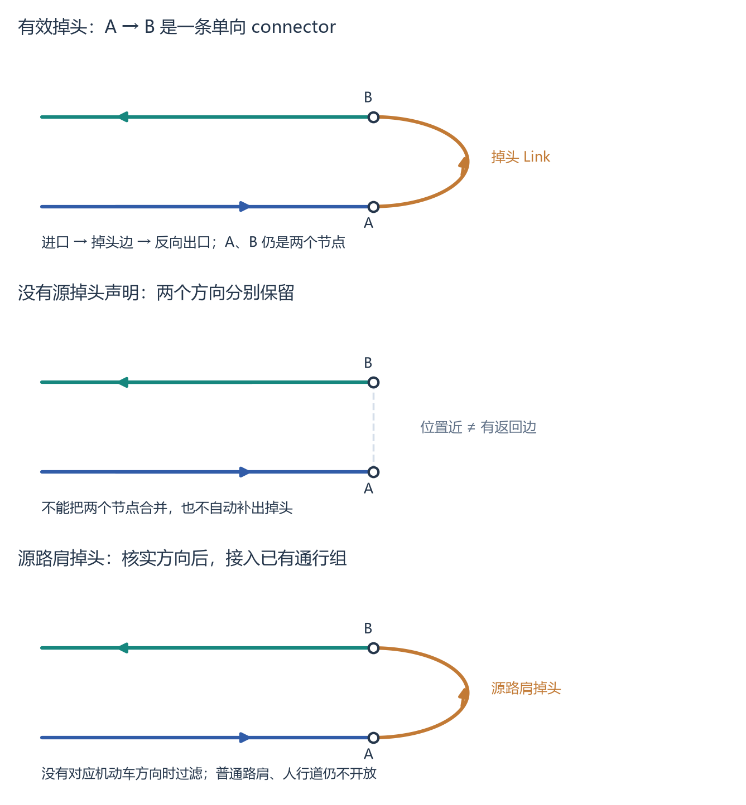

有源路径才接掉头；路肩路径还需匹配实际行驶方向。

代码按以下顺序处理：

1. **读取源连接。** collect_connections() 读取 junction、connection、道路 ID、contactPoint 和 laneLink。连接路缺少进口 road/link 时，只有能从源关系唯一确定进口端才补齐；冲突或不唯一时报出源 ID。
2. **找到出口车道组。** 根据连接 road 的 road/link 找相邻道路，再按车道配对确定进出口组。跨 laneSection 换号沿 predecessor/successor 追踪；路肩路径用 _lane_chain() 检查完整性。
3. **核对类型和方向。** 默认纳入 driving、bidirectional；路肩掉头另查进出口是否有同侧同方向的通行组，不给单向道路增加逆行方向。
4. **计算中线和节点。** lanes 计算组中线，topology、builder 确定节点，点列按行驶方向排列：进口终点接掉头起点，掉头终点接反向出口起点。
5. **对齐源弧，再合并。** endpoints 把源弧接到固定节点；_merge_turns() 合并同 junction、同起终节点的掉头路径，并保留源引用。反向掉头需另有源路径。
6. **核对有向链。** movement_report() 检查指定进出口的接续、独立节点和弧形有效性。

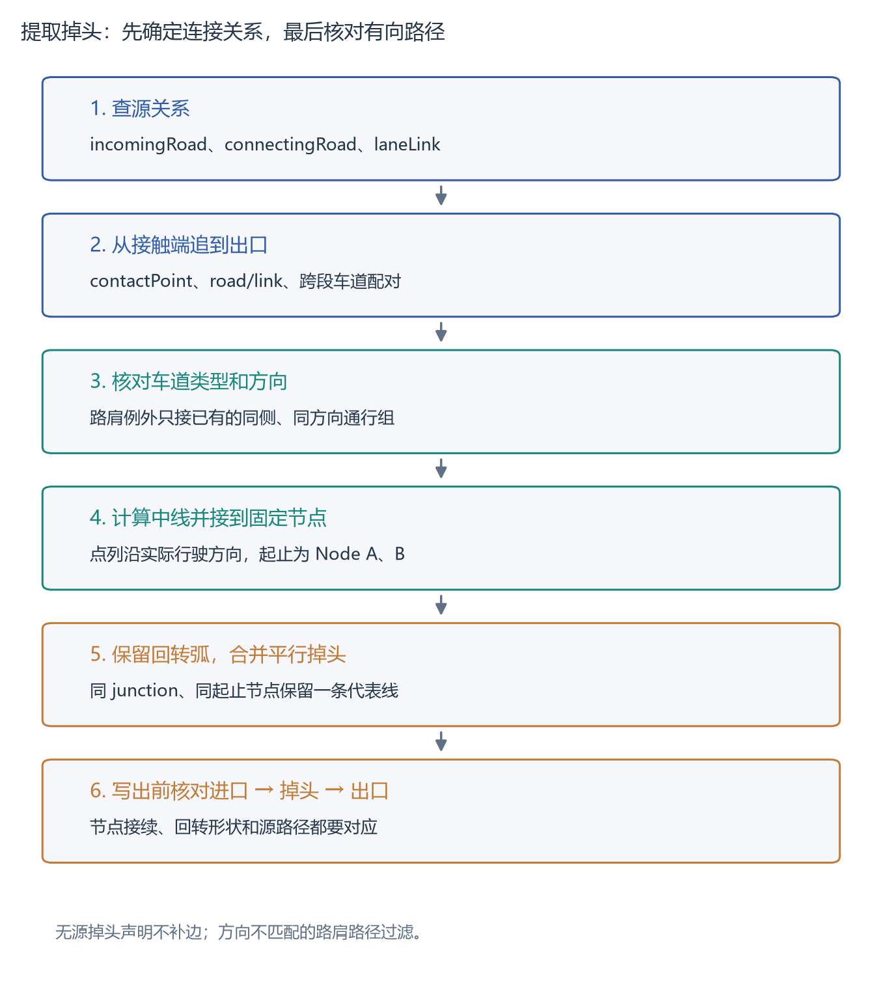

读取源连接 → 计算中线和节点 → 核对有向路径。

**角度只用于识别和保护已有路径。** 弧形保护要求源中线首末方向差至少 145°，弧长超过端点直线距离的 1.1 倍。独立覆盖复核按源道路端点航向计算进出夹角，避免把局部回折误认为掉头。不到 145° 的普通可通行 connector 仍保留，只是不按掉头保护。

### 10.3. 线头接到节点后，回转弧怎样保住

#### 10.3.1. 固定两端，沿整条源弧分摊偏移

源掉头中线对应具体车道，Node 代表整个车道组，两者可能横向错开。只移动线头再做普通平滑，可能把回转弧压窄或削成短线。

align_uturn_to_nodes() 沿源弧分摊两端偏移，固定目标节点并保留回转。已识别的掉头跳过普通高斯平滑、贴线、拉直和常规拟合。位移过大、自交或无法保留回转形状时，报错，不用直线兜底。

写出前还要确认两段接续关系：

- 进口 Link 的 to_node = 掉头 Link 的 from_node。
- 掉头 Link 的 to_node = 反向出口 Link 的 from_node。

弱连通只说明忽略方向后相连，不能证明顺向可通行。源进出口明确的掉头若接续或几何检查失败，会在替换正式输出前终止构建；源关系不完整的记录单独报告。

#### 10.3.2. 路肩掉头按实际方向接入，普通路肩不随之开放

有些地图把整条掉头路径及前后连接车道标为 shoulder。代码只保留其中能从实际机动车进口接到反向出口的路径，源类型仍为 shoulder。

retain_shoulder_uturns() 沿 junction/laneLink 和车道连接追踪完整路肩路径。中间混入其他类型、缺少出口连接或接点不唯一时，过滤该路径。进出车道属于通行组时直接匹配；本身为路肩时，按车道编号找同侧同方向最近的组，两个组同样近时不强行配对。

Town03 Road 1202、1688 和 Town06 Road 719 的源弧较窄，距机动车组节点约 4～6 m。核实路径后，可沿横向展开源弧，并检查回转、自交和折角；明显纵向拖拽拒绝。路肩掉头节点只配指定组，不参加距离吸附。

方向不匹配仍要过滤。例如 Town06 Road 745 接到 Road 45 的逆行方向，而该 road 没有这个方向的机动车车道。普通路肩、人行道、无源路径的掉头和同节点自环也不因该例外进入路网。

### 10.4. 实际提取效果：一般掉头与路肩掉头

#### 10.4.1. 实例：两条源路径，合成一条掉头 Link

实例 junction 190 中，Road 191、194 都从 Road 202310038 接到 Road 202310008，连接车道标为 driving，驶入、驶出方向相差约 178°。第 10.1 节的 XML 摘录就是其中的 Road 194。

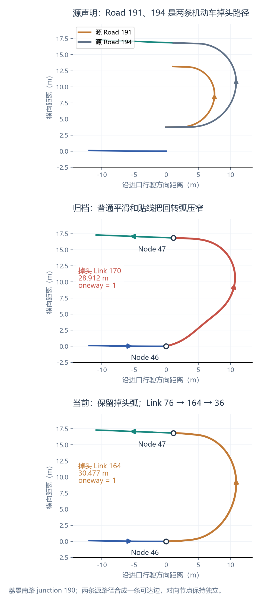

上图为源掉头路径，中图为压窄的旧结果，下图为保留回转弧的当前结果。

当前有向链为 **Link 76→164→36**，对应 **Node 60→46→47→58**。掉头 Link 164 长约 30.477 m，n_merged=1；Node 46、47 分别为进口和反向出口。省略重复辅道后，原 Link 170 重编号为 164，几何、节点和方向未变。

Road 191 与 Road 194 同起终节点，已合入 Link 164，源引用仍保留。关闭转向合并后，两条都会输出；JunctionLink 也分别保留。因此检查漏提要核对来源和有向可达，不能只看 road_id 是否单独出现。

#### 10.4.2. Town03、Town06：补进三条方向接通的路肩掉头

启用路肩例外后，Town03 新增 Road 1202、1688 的两条掉头，Town06 新增 Road 719 的一条掉头。原有道路 Link 几何和 Node 坐标保持一致，新增边的两端接到已有机动车节点。

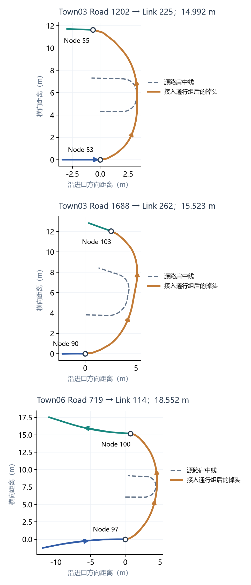

灰线为源路肩中线，橙线为接入机动车节点后的单向掉头。

上述样例的四条掉头接续结果如下。箭头为行驶方向，长度按输出几何计算。

| 数据     | 源 connecting road | 掉头 Link（起止 Node） | 进口→掉头→出口 Link | 长度 / m |
| ------ | ----------------- | ---------------- | ------------- | ------ |
| 实例     | 191、194           | 164（46→47）       | 76→164→36     | 30.477 |
| Town03 | 1202              | 225（53→55）       | 69→225→56     | 14.992 |
| Town03 | 1688              | 262（90→103）      | 25→262→43     | 15.523 |
| Town06 | 719               | 114（97→100）      | 52→114→54     | 18.552 |

四条边均为 link_type=connector、oneway=1、passable=1。Link 表没有 turn_type="uturn" 字段，不能只按 connector 数量统计掉头。

### 10.6. 能否满足我们的路网要求

上述样例的掉头能以单向 Link 接入路网，源路径可追溯，进出口顺向接续，回转弧保留，覆盖范围见下表。

| 要求                 | 当前结论      | 依据或边界                                 |
| ------------------ | --------- | ------------------------------------- |
| 每条 Link 只表达一个行驶方向  | 满足        | 四条掉头均为单向边，点列首末对应 from_node、to_node    |
| 掉头能从进口走到反向出口       | 本批已核实路径满足 | 五条源路径都能追到输出，形成表中四条有向链                 |
| 对向道路接点分别表达         | 满足        | 保持已有独立节点，不为表示掉头合并进口与出口                |
| 回转弧不被拉直或压成短线       | 已通过当前案例检查 | 源弧独立对齐，跳过普通整理；检查弧形有效性、自交和接续           |
| 路肩只保留能按实际方向接通的掉头   | 满足        | 三条保留，七条方向不匹配的候选过滤；普通路肩和人行道不开放         |
| 所有地图、所有掉头建模方式都完整覆盖 | 尚不能确认     | 有缺失源关系，也未完成多段掉头和其他路口格式的专项核验           |
| 直接作为完整车辆导航或自动驾驶模型  | 仍需补充      | 未完整表达车道变换、车辆权限、交通标志和信号控制；代表线也不是精确车辆轨迹 |

## 11. 结果检查

### 11.2. 几何检查

| 检查                     | 要发现什么                      |
| ---------------------- | -------------------------- |
| Link、Node ID 唯一，节点引用存在 | 重复 ID、悬空 from_node/to_node |
| 每条 Link 的首末坐标对应节点      | 看着相接，实际上还留缝                |
| 坐标顺序和单向约定              | 车流画反、两方向重复生成               |
| 入度、出度与 Link 表一致        | 节点计数漏算或沿用旧值                |
| 几何长度与 length 一致        | 修改线形后没有重算长度                |
| 检查全部内部折角和自交            | 短线、末段、小接缝里的毛刺              |
| 对向分离与共享车道标记            | 普通双向压成一线，或误报合法共享共线         |
| 与源节点和车道组对照             | 两方向误合并、辅道串到主组、混合连接遗漏       |
| 每对线的穿越变化               | 新增无来源交叉，或同一对象多穿一次          |

折角检查也要覆盖短线和端点附近。输出几何合法，仍需核对源连接。

直行、转弯和联合调整检查源偏离、方向、长度及交叉；贴线另有局部判定。这些检查不等于完整交通验证。

### 11.4. 字段检查

核对 Link 的 road、车道组、通行标志和质量字段。道路级 Link 只概括部分源信息，完整语义仍需查看 OpenDRIVE。

## 12. 把整个处理过程串起来

### 12.1. 当前流程中的先后关系

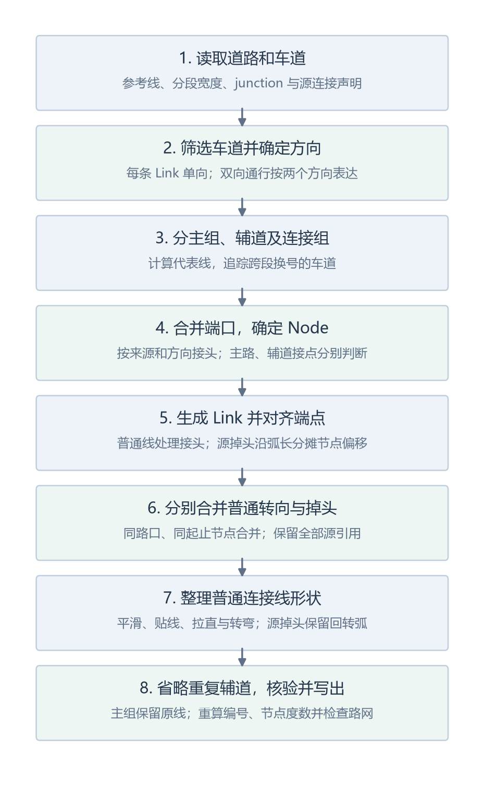

从车道筛选、分组和节点配对，到线形整理与结果核验。

处理顺序要注意：

1. 先筛选通行车道，避免为占位车道登记节点；计算位置仍累计完整宽度。
2. 主组、辅道先分清，再决定各条连接线接到哪组。
3. Node 先定，Link 首末坐标才有明确目标。
4. 转向合并前，起终节点必须已经正确。
5. 线形处理后省略重复辅道，再重新核对长度、端点、属性与交叉。
